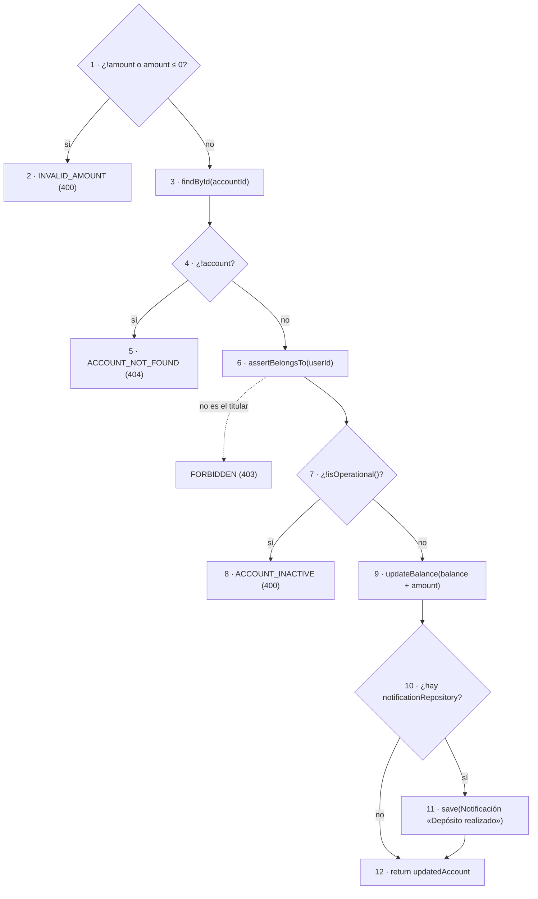

# Pruebas unitarias de caja blanca — Módulo Bolsillos y Depositar (Backend)

Casos derivados de las **tablas de camino** del diagrama `Backend.drawio`.
Cada caso corresponde a una fila de la tabla de una de las cinco hojas del diagrama:
se declara la secuencia de nodos, las condiciones que hay que forzar en cada decisión,
las entradas concretas que lo consiguen, el resultado esperado y el resultado obtenido
al ejecutar el caso de uso real contra repositorios en memoria.

La sexta funcionalidad, **Depositar dinero** (módulo Cuentas), se agregó el 2026-10-26 con la
misma técnica. Como `Backend.drawio` no tiene una hoja para ella, sus nodos se numeran en la
propia sección [Depositar dinero](#depositar-dinero) y en el encabezado de la prueba.

| | Bolsillos (5 funcionalidades) | Depositar dinero |
| --- | --- | --- |
| **Fecha de ejecución** | 2026-08-25 | 2026-10-26 |
| **Versión probada** | main-04800eb | rama `tests/bolsillos-katalon` @ df760a8 (la prueba aún no está commiteada) |
| **Cómo reproducir** | `npm run test:paths` desde `backend/` (runner `tsx` legacy: el script ya no figura en `package.json`) | `npx vitest run src/tests/unit/account/DepositMoney.paths.test.ts` desde `backend/` |

- **Entorno:** Backend (Node), repositorios en memoria, sin Supabase
- **Técnica:** prueba de caminos básicos (McCabe) sobre los casos de uso de la capa de aplicación

## Resumen

| Funcionalidad | Caminos probados | Aprobados | Fallidos | No ejecutables |
| --- | ---: | ---: | ---: | ---: |
| Crear bolsillo | 7 | 6 | 1 | 0 |
| Actualizar bolsillo | 11 | 11 | 0 | 0 |
| Eliminar bolsillo | 5 | 5 | 0 | 0 |
| Transferir entre bolsillos | 10 | 10 | 0 | 0 |
| Consultar bolsillos | 3 | 3 | 0 | 0 |
| Depositar dinero (Cuentas) | 8 | 8 | 0 | 0 |
| **Total** | **44** | **43** | **1** | **0** |

## Índice de casos

| ID | Funcionalidad | Camino | Secuencia | Estado |
| --- | --- | --- | --- | --- |
| BE-CR-C1 | Crear bolsillo | Camino 1 | `1 → 3 → Fin` | ✅ Aprobado |
| BE-CR-C2 | Crear bolsillo | Camino 2 | `1 → 2 → 4 → 6 → Fin` | ✅ Aprobado |
| BE-CR-C3 | Crear bolsillo | Camino 3 | `1 → 2 → 4 → 5 → 7 → 9 → Fin` | ✅ Aprobado |
| BE-CR-C4 | Crear bolsillo | Camino 4 | `1 → 2 → 4 → 5 → 7 → 8 → 10 → 12 → Fin` | ✅ Aprobado |
| BE-CR-C5 | Crear bolsillo | Camino 5 | `1 → 2 → 4 → 5 → 7 → 8 → 10 → 11 → 13 → 14 → 16 → 15 → Fin` | ✅ Aprobado |
| BE-CR-C6 | Crear bolsillo | Camino 6 | `1 → 2 → 4 → 5 → 7 → 8 → 10 → 11 → 13 → 14 → 15 → Fin` | ✅ Aprobado |
| BE-CR-C5b | Crear bolsillo | Camino 5 (variante con reserva previa) | `1 → 2 → 4 → 5 → 7 → 8 → 10 → 11 → 13 → 14 → 16 → 15 → Fin` | ❌ Fallido |
| BE-AC-C1 | Actualizar bolsillo | Camino 1 | `1 → 3 → Fin` | ✅ Aprobado |
| BE-AC-C2 | Actualizar bolsillo | Camino 2 | `1 → 2 → 5 → Fin` | ✅ Aprobado |
| BE-AC-C3 | Actualizar bolsillo | Camino 3 | `1 → 2 → 4 → 6 → 7 → 9 → Fin` | ✅ Aprobado |
| BE-AC-C4 | Actualizar bolsillo | Camino 4 | `1 → 2 → 4 → 6 → 7 → 8 → 10 → 12 → Fin` | ✅ Aprobado |
| BE-AC-C5 | Actualizar bolsillo | Camino 5 | `1 → 2 → 4 → 6 → 7 → 8 → 10 → 11 → 13 → 15 → Fin` | ✅ Aprobado |
| BE-AC-C6 | Actualizar bolsillo | Camino 6 | `1 → 2 → 4 → 6 → 7 → 8 → 10 → 11 → 13 → 14 → 17 → 19 → Fin` | ✅ Aprobado |
| BE-AC-C7 | Actualizar bolsillo | Camino 7 | `1 → 2 → 4 → 6 → 7 → 8 → 10 → 11 → 13 → 14 → 17 → 18 → 26 → 25 → Fin` | ✅ Aprobado |
| BE-AC-C8 | Actualizar bolsillo | Camino 8 | `1 → 2 → 4 → 6 → 7 → 8 → 10 → 11 → 13 → 14 → 16 → 21 → 26 → Fin` | ✅ Aprobado |
| BE-AC-C9 | Actualizar bolsillo | Camino 9 | `1 → 2 → 4 → 6 → 7 → 8 → 10 → 11 → 13 → 14 → 16 → 20 → 23 → Fin` | ✅ Aprobado |
| BE-AC-C10 | Actualizar bolsillo | Camino 10 | `1 → 2 → 4 → 6 → 7 → 8 → 10 → 11 → 13 → 14 → 16 → 20 → 22 → 24 → 26 → 25 → Fin` | ✅ Aprobado |
| BE-AC-C11 | Actualizar bolsillo | Camino 11 | `1 → 2 → 4 → 6 → 7 → 8 → 10 → 11 → 13 → 14 → 16 → 20 → 22 → 24 → 25 → Fin` | ✅ Aprobado |
| BE-EL-C1 | Eliminar bolsillo | Camino 1 | `1 → 2 → 4 → Fin` | ✅ Aprobado |
| BE-EL-C2 | Eliminar bolsillo | Camino 2 | `1 → 2 → 3 → 5 → 7 → Fin` | ✅ Aprobado |
| BE-EL-C3 | Eliminar bolsillo | Camino 3 | `1 → 2 → 3 → 5 → 6 → 8 → 10 → Fin` | ✅ Aprobado |
| BE-EL-C4 | Eliminar bolsillo | Camino 4 | `1 → 2 → 3 → 5 → 6 → 8 → 9 → 11 → 12 → 13 → 14 → 15 → Fin` | ✅ Aprobado |
| BE-EL-C5 | Eliminar bolsillo | Camino 5 | `1 → 2 → 3 → 5 → 6 → 8 → 9 → 11 → 12 → 13 → 14 → 16 → Fin` | ✅ Aprobado |
| BE-TR-C1 | Transferir entre bolsillos | Camino 1 | `1 → 3 → Fin` | ✅ Aprobado |
| BE-TR-C2 | Transferir entre bolsillos | Camino 2 | `1 → 2 → 5 → Fin` | ✅ Aprobado |
| BE-TR-C3 | Transferir entre bolsillos | Camino 3 | `1 → 2 → 4 → 6 → 8 → Fin` | ✅ Aprobado |
| BE-TR-C4 | Transferir entre bolsillos | Camino 4 | `1 → 2 → 4 → 6 → 7 → 9 → 11 → Fin` | ✅ Aprobado |
| BE-TR-C5 | Transferir entre bolsillos | Camino 5 | `1 → 2 → 4 → 6 → 7 → 9 → 10 → 13 → Fin` | ✅ Aprobado |
| BE-TR-C6 | Transferir entre bolsillos | Camino 6 | `1 → 2 → 4 → 6 → 7 → 9 → 10 → 12 → 14 → 16 → Fin` | ✅ Aprobado |
| BE-TR-C7 | Transferir entre bolsillos | Camino 7 | `1 → 2 → 4 → 6 → 7 → 9 → 10 → 12 → 14 → 15 → 17 → 19 → Fin` | ✅ Aprobado |
| BE-TR-C8 | Transferir entre bolsillos | Camino 8 | `1 → 2 → 4 → 6 → 7 → 9 → 10 → 12 → 14 → 15 → 17 → 18 → 21 → Fin` | ✅ Aprobado |
| BE-TR-C9 | Transferir entre bolsillos | Camino 9 | `1 → 2 → 4 → 6 → 7 → 9 → 10 → 12 → 14 → 15 → 17 → 18 → 20 → 22 → 23 → 24 → 25 → 26 → Fin` | ✅ Aprobado |
| BE-TR-C11 | Transferir entre bolsillos | Camino 11 | `1 → 2 → 4 → 6 → 7 → 9 → 10 → 12 → 14 → 15 → 17 → 18 → 20 → 22 → 23 → 24 → 25 → 27 → Fin` | ✅ Aprobado |
| BE-CO-C1 | Consultar bolsillos | Camino 1 | `1 → 2 → 4 → Fin` | ✅ Aprobado |
| BE-CO-C2 | Consultar bolsillos | Camino 2 | `1 → 2 → 3 → 5 → 6 → Fin` | ✅ Aprobado |
| BE-CO-C2b | Consultar bolsillos | Camino 2 (rechazo en el nodo 3, no tabulado) | `1 → 2 → 3 → Fin (salida por excepción)` | ✅ Aprobado |
| BE-DE-C1 | Depositar dinero | Camino 1 | `1 → 2 → Fin` | ✅ Aprobado |
| BE-DE-C1b | Depositar dinero | Camino 1 (segunda cláusula de la condición) | `1 → 2 → Fin` | ✅ Aprobado |
| BE-DE-C2 | Depositar dinero | Camino 2 | `1 → 3 → 4 → 5 → Fin` | ✅ Aprobado |
| BE-DE-C2b | Depositar dinero | Camino 2 (rechazo en el nodo 6, no tabulado) | `1 → 3 → 4 → 6 → Fin (salida por excepción)` | ✅ Aprobado |
| BE-DE-C3 | Depositar dinero | Camino 3 | `1 → 3 → 4 → 6 → 7 → 8 → Fin` | ✅ Aprobado |
| BE-DE-C4 | Depositar dinero | Camino 4 | `1 → 3 → 4 → 6 → 7 → 9 → 10 → 11 → 12 → Fin` | ✅ Aprobado |
| BE-DE-C4b | Depositar dinero | Camino 4 (valor límite) | `1 → 3 → 4 → 6 → 7 → 9 → 10 → 11 → 12 → Fin` | ✅ Aprobado |
| BE-DE-C5 | Depositar dinero | Camino 5 | `1 → 3 → 4 → 6 → 7 → 9 → 10 → 12 → Fin` | ✅ Aprobado |

## Crear bolsillo

Caso de uso bajo prueba: `CreatePocket.execute`

### BE-CR-C1 — Camino 1

| Campo | Contenido |
| --- | --- |
| **Secuencia de nodos** | `1 → 3 → Fin` |
| **Condiciones forzadas** | • N1 (dto.amount < 0) = VERDADERO |
| **Entradas** | • Cuenta de ahorros ACTIVA del propietario, saldo = $1.000, sin bolsillos • dto = { userId: propietario, accountId: cuenta.id, name: "Monto negativo", amount: -1 } |
| **Resultado esperado** | Se lanza AppError INVALID_POCKET_AMOUNT (HTTP 400) en el nodo 3. No se consulta la cuenta ni se altera el saldo. |
| **Resultado obtenido** | Rechazado con INVALID_POCKET_AMOUNT · HTTP 400 · "El monto del bolsillo no puede ser negativo" · saldo intacto en $1.000 · bolsillos creados: 0 |
| **Estado** | ✅ **Aprobado** |

### BE-CR-C2 — Camino 2

| Campo | Contenido |
| --- | --- |
| **Secuencia de nodos** | `1 → 2 → 4 → 6 → Fin` |
| **Condiciones forzadas** | • N1 (dto.amount < 0) = FALSO • N4 (!account) = VERDADERO |
| **Entradas** | • Repositorio de cuentas vacío • dto = { userId: propietario, accountId: UUID aleatorio inexistente, name: "Fantasma", amount: 100 } |
| **Resultado esperado** | Se ejecuta findById (nodo 2), devuelve null y se lanza AppError ACCOUNT_NOT_FOUND (HTTP 404) en el nodo 6. |
| **Resultado obtenido** | Rechazado con ACCOUNT_NOT_FOUND · HTTP 404 · "Cuenta no encontrada" · accountId consultado: 2fe76d3b-ba0e-41c8-97f6-744e122443e3 · bolsillos creados: 0 |
| **Estado** | ✅ **Aprobado** |

### BE-CR-C3 — Camino 3

| Campo | Contenido |
| --- | --- |
| **Secuencia de nodos** | `1 → 2 → 4 → 5 → 7 → 9 → Fin` |
| **Condiciones forzadas** | • N1 (dto.amount < 0) = FALSO • N4 (!account) = FALSO • N5 (assertBelongsTo) no lanza: el usuario es el propietario • N7 (!account.isOperational()) = VERDADERO |
| **Entradas** | • Cuenta de ahorros del propietario en estado BLOQUEADA, saldo = $1.000 • dto = { userId: propietario, accountId: cuenta.id, name: "Cuenta bloqueada", amount: 100 } |
| **Resultado esperado** | assertBelongsTo pasa (nodo 5) y, al no estar la cuenta ACTIVA, se lanza AppError ACCOUNT_NOT_OPERATIONAL (HTTP 400) en el nodo 9. |
| **Resultado obtenido** | Rechazado con ACCOUNT_NOT_OPERATIONAL · HTTP 400 · "La cuenta no está disponible para generar bolsillos" · estado de la cuenta: BLOQUEADA · saldo intacto en $1.000 |
| **Estado** | ✅ **Aprobado** |

### BE-CR-C4 — Camino 4

| Campo | Contenido |
| --- | --- |
| **Secuencia de nodos** | `1 → 2 → 4 → 5 → 7 → 8 → 10 → 12 → Fin` |
| **Condiciones forzadas** | • N1 = FALSO • N4 = FALSO • N7 = FALSO (cuenta ACTIVA) • N10 (currentReserved + dto.amount > account.balance) = VERDADERO |
| **Entradas** | • Cuenta de ahorros ACTIVA del propietario, saldo = $1.000, sin bolsillos (currentReserved = $0) • dto = { userId: propietario, accountId: cuenta.id, name: "Excede saldo", amount: 1001 } • Valor límite: monto = saldo + 1 |
| **Resultado esperado** | currentReserved (0) + 1001 > 1000, por lo que se lanza AppError INSUFFICIENT_AVAILABLE_BALANCE (HTTP 400) en el nodo 12 sin tocar el saldo. |
| **Resultado obtenido** | Rechazado con INSUFFICIENT_AVAILABLE_BALANCE · HTTP 400 · "No tienes saldo disponible suficiente para crear este bolsillo" · reservado previo $0 + monto $1.001 > saldo $1.000 · saldo intacto en $1.000 |
| **Estado** | ✅ **Aprobado** |

### BE-CR-C5 — Camino 5

| Campo | Contenido |
| --- | --- |
| **Secuencia de nodos** | `1 → 2 → 4 → 5 → 7 → 8 → 10 → 11 → 13 → 14 → 16 → 15 → Fin` |
| **Condiciones forzadas** | • N1 = FALSO • N4 = FALSO • N7 = FALSO • N10 = FALSO (hay saldo disponible suficiente) • N14 (notificationRepository presente) = VERDADERO |
| **Entradas** | • Cuenta de ahorros ACTIVA del propietario, saldo = $1.000, sin bolsillos • CreatePocket construido CON repositorio de notificaciones • dto = { userId: propietario, accountId: cuenta.id, name: "Vacaciones", amount: 300 } |
| **Resultado esperado** | Se descuenta el monto del saldo (nodo 11), se guarda el bolsillo (nodo 13), se registra la notificación "Bolsillo creado" (nodo 16) y se retorna saved.toPublic() (nodo 15). Saldo final = $700. |
| **Resultado obtenido** | Bolsillo "Vacaciones" creado por $300 · saldo $1.000 → $700 · notificación registrada: "Bolsillo creado" (BOLSILLO) · respuesta toPublic() con id 2c17c921-04e9-4ed2-873e-f578142cb226 |
| **Estado** | ✅ **Aprobado** |

### BE-CR-C6 — Camino 6

| Campo | Contenido |
| --- | --- |
| **Secuencia de nodos** | `1 → 2 → 4 → 5 → 7 → 8 → 10 → 11 → 13 → 14 → 15 → Fin` |
| **Condiciones forzadas** | • N1 = FALSO • N4 = FALSO • N7 = FALSO • N10 = FALSO • N14 (notificationRepository presente) = FALSO |
| **Entradas** | • Cuenta de ahorros ACTIVA del propietario, saldo = $1.000, sin bolsillos • CreatePocket construido SIN repositorio de notificaciones (parámetro opcional omitido) • dto = { userId: propietario, accountId: cuenta.id, name: "Sin notificación", amount: 300 } |
| **Resultado esperado** | El bolsillo se crea y el saldo baja a $700 igual que en el camino 5, pero se salta el nodo 16: no se registra ninguna notificación. |
| **Resultado obtenido** | Bolsillo "Sin notificación" creado por $300 · saldo $1.000 → $700 · notificaciones registradas: 0 (nodo 16 no recorrido) |
| **Estado** | ✅ **Aprobado** |

### BE-CR-C5b — Camino 5 (variante con reserva previa)

| Campo | Contenido |
| --- | --- |
| **Secuencia de nodos** | `1 → 2 → 4 → 5 → 7 → 8 → 10 → 11 → 13 → 14 → 16 → 15 → Fin` |
| **Condiciones forzadas** | • N1 = FALSO • N4 = FALSO • N7 = FALSO • N10 = FALSO — el monto solicitado cabe en el saldo disponible • N14 = VERDADERO |
| **Entradas** | • Cuenta de ahorros ACTIVA del propietario, saldo inicial = $1.000 • Bolsillo previo "Reserva grande" de $800 (tras crearlo el saldo disponible queda en $200) • dto = { userId: propietario, accountId: cuenta.id, name: "Segundo bolsillo", amount: 150 } |
| **Resultado esperado** | El monto $150 cabe en el saldo disponible de $200, por lo que N10 debe ser FALSO y el bolsillo debe crearse dejando el saldo disponible en $50. |
| **Resultado obtenido** | FALLO: El flujo tomó el camino 4 (nodo 12) en lugar del camino 5: INSUFFICIENT_AVAILABLE_BALANCE — "No tienes saldo disponible suficiente para crear este bolsillo". Saldo disponible $200, ya reservado $800, monto solicitado $150. Defecto: la decisión del nodo 10 compara "currentReserved + amount > account.balance", pero account.balance ya es el saldo DISPONIBLE (el reservado se descontó en el nodo 11 de creaciones anteriores), de modo que el monto reservado se cuenta dos veces y se rechazan bolsillos que sí caben. |
| **Estado** | ❌ **Fallido** |

## Actualizar bolsillo

Caso de uso bajo prueba: `UpdatePocket.execute`

### BE-AC-C1 — Camino 1

| Campo | Contenido |
| --- | --- |
| **Secuencia de nodos** | `1 → 3 → Fin` |
| **Condiciones forzadas** | • N1 (name definido y sin contenido tras trim) = VERDADERO |
| **Entradas** | • No hace falta estado previo: la validación precede a toda consulta • dto = { userId: propietario, pocketId: UUID cualquiera, name: "   " } |
| **Resultado esperado** | Se lanza AppError INVALID_POCKET_NAME (HTTP 400) en el nodo 3, sin consultar el repositorio de bolsillos. |
| **Resultado obtenido** | Rechazado con INVALID_POCKET_NAME · HTTP 400 · "El nombre del bolsillo no puede estar vacío" · entrada name = "   " (3 espacios, longitud tras trim = 0) |
| **Estado** | ✅ **Aprobado** |

### BE-AC-C2 — Camino 2

| Campo | Contenido |
| --- | --- |
| **Secuencia de nodos** | `1 → 2 → 5 → Fin` |
| **Condiciones forzadas** | • N1 = FALSO (name no se envía) • N2 (amount definido y < 0) = VERDADERO |
| **Entradas** | • dto = { userId: propietario, pocketId: UUID cualquiera, amount: -1 } |
| **Resultado esperado** | Se lanza AppError INVALID_POCKET_AMOUNT (HTTP 400) en el nodo 5. |
| **Resultado obtenido** | Rechazado con INVALID_POCKET_AMOUNT · HTTP 400 · "El monto del bolsillo no puede ser negativo" · entrada amount = -1 (valor límite inmediatamente inferior a 0) |
| **Estado** | ✅ **Aprobado** |

### BE-AC-C3 — Camino 3

| Campo | Contenido |
| --- | --- |
| **Secuencia de nodos** | `1 → 2 → 4 → 6 → 7 → 9 → Fin` |
| **Condiciones forzadas** | • N1 = FALSO • N2 = FALSO • N7 (!pocket) = VERDADERO |
| **Entradas** | • Repositorio de bolsillos vacío • dto = { userId: propietario, pocketId: UUID aleatorio inexistente, amount: 100 } |
| **Resultado esperado** | findById (nodos 4-6) devuelve null y se lanza AppError POCKET_NOT_FOUND (HTTP 404) en el nodo 9. |
| **Resultado obtenido** | Rechazado con POCKET_NOT_FOUND · HTTP 404 · "Bolsillo no encontrado" · pocketId consultado: 5b214277-92df-4e77-9f13-5835ff20a2e9 |
| **Estado** | ✅ **Aprobado** |

### BE-AC-C4 — Camino 4

| Campo | Contenido |
| --- | --- |
| **Secuencia de nodos** | `1 → 2 → 4 → 6 → 7 → 8 → 10 → 12 → Fin` |
| **Condiciones forzadas** | • N1 = FALSO • N2 = FALSO • N7 = FALSO • N10 (!account) = VERDADERO |
| **Entradas** | • Bolsillo "Huérfano" de $100 sembrado directamente en el repositorio, apuntando a un accountId que no existe • dto = { userId: propietario, pocketId: bolsillo.id, amount: 200 } |
| **Resultado esperado** | El bolsillo se encuentra (nodo 7 falso) pero su cuenta no (nodo 10 verdadero): se lanza AppError ACCOUNT_NOT_FOUND (HTTP 404) en el nodo 12. |
| **Resultado obtenido** | Rechazado con ACCOUNT_NOT_FOUND · HTTP 404 · "Cuenta no encontrada" · accountId del bolsillo: b510e0a2-5106-472e-aa73-631ed232920d · monto del bolsillo intacto en $100 |
| **Estado** | ✅ **Aprobado** |

### BE-AC-C5 — Camino 5

| Campo | Contenido |
| --- | --- |
| **Secuencia de nodos** | `1 → 2 → 4 → 6 → 7 → 8 → 10 → 11 → 13 → 15 → Fin` |
| **Condiciones forzadas** | • N1 = FALSO • N2 = FALSO • N7 = FALSO • N10 = FALSO • N11 (assertBelongsTo) no lanza: el usuario es el propietario • N13 (!account.isOperational()) = VERDADERO |
| **Entradas** | • Cuenta de ahorros del propietario con un bolsillo "Vacaciones" de $300; la cuenta se bloquea después de crearlo • dto = { userId: propietario, pocketId: bolsillo.id, amount: 400 } |
| **Resultado esperado** | Se lanza AppError ACCOUNT_NOT_OPERATIONAL (HTTP 400) en el nodo 15 y el bolsillo conserva su monto original. |
| **Resultado obtenido** | Rechazado con ACCOUNT_NOT_OPERATIONAL · HTTP 400 · "La cuenta no está disponible para modificar bolsillos" · estado de la cuenta: BLOQUEADA · monto del bolsillo intacto en $300 |
| **Estado** | ✅ **Aprobado** |

### BE-AC-C6 — Camino 6

| Campo | Contenido |
| --- | --- |
| **Secuencia de nodos** | `1 → 2 → 4 → 6 → 7 → 8 → 10 → 11 → 13 → 14 → 17 → 19 → Fin` |
| **Condiciones forzadas** | • N13 = FALSO (cuenta ACTIVA) • N14 (amount definido y distinto del actual) = VERDADERO • N17 (newReservedTotal > account.balance + totalReserved) = VERDADERO |
| **Entradas** | • Cuenta ACTIVA con saldo inicial $1.000 y bolsillo "Vacaciones" de $300 (saldo disponible $700, reservado $300) • dto = { userId: propietario, pocketId: bolsillo.id, amount: 1001 } • Valor límite: 1001 > 700 + 300 = 1000 |
| **Resultado esperado** | Se lanza AppError INSUFFICIENT_AVAILABLE_BALANCE (HTTP 400) en el nodo 19 sin tocar el saldo ni el bolsillo. |
| **Resultado obtenido** | Rechazado con INSUFFICIENT_AVAILABLE_BALANCE · HTTP 400 · "No tienes saldo disponible suficiente para ajustar este bolsillo" · saldo disponible intacto en $700 · monto del bolsillo intacto en $300 |
| **Estado** | ✅ **Aprobado** |

### BE-AC-C7 — Camino 7

| Campo | Contenido |
| --- | --- |
| **Secuencia de nodos** | `1 → 2 → 4 → 6 → 7 → 8 → 10 → 11 → 13 → 14 → 17 → 18 → 26 → 25 → Fin` |
| **Condiciones forzadas** | • N14 (amount definido y distinto) = VERDADERO • N17 (saldo insuficiente) = FALSO • N24 (notificationRepository presente) = VERDADERO |
| **Entradas** | • Cuenta ACTIVA con saldo inicial $1.000 y bolsillo "Vacaciones" de $300 (saldo disponible $700) • dto = { userId: propietario, pocketId: bolsillo.id, amount: 500 } |
| **Resultado esperado** | El nodo 18 ajusta el saldo por la diferencia (delta = 500 − 300 = 200) dejándolo en $500, el bolsillo pasa a $500, se registra la notificación "Bolsillo actualizado" (nodo 26) y se retorna updated.toPublic() (nodo 25). |
| **Resultado obtenido** | Monto $300 → $500 · saldo disponible $700 → $500 · notificación: "Bolsillo actualizado" — "Actualizaste el bolsillo "Vacaciones"" |
| **Estado** | ✅ **Aprobado** |

### BE-AC-C8 — Camino 8

| Campo | Contenido |
| --- | --- |
| **Secuencia de nodos** | `1 → 2 → 4 → 6 → 7 → 8 → 10 → 11 → 13 → 14 → 16 → 21 → 26 → Fin` |
| **Condiciones forzadas** | • N14 (amount definido y distinto) = FALSO — no se envía amount • N16 (name definido y distinto del actual) = VERDADERO • N24 = VERDADERO |
| **Entradas** | • Cuenta ACTIVA con saldo inicial $1.000 y bolsillo "Vacaciones" de $300 (saldo disponible $700) • dto = { userId: propietario, pocketId: bolsillo.id, name: "Viaje a la costa" } |
| **Resultado esperado** | El nodo 21 renombra el bolsillo, el monto y el saldo quedan igual ($300 y $700) y se registra la notificación. |
| **Resultado obtenido** | Nombre "Vacaciones" → "Viaje a la costa" · monto sin cambios $300 · saldo sin cambios $700 · notificación registrada |
| **Estado** | ✅ **Aprobado** |

### BE-AC-C9 — Camino 9

| Campo | Contenido |
| --- | --- |
| **Secuencia de nodos** | `1 → 2 → 4 → 6 → 7 → 8 → 10 → 11 → 13 → 14 → 16 → 20 → 23 → Fin` |
| **Condiciones forzadas** | • N14 = FALSO (no se envía amount) • N16 = FALSO (no se envía name) • N20 (amount y name ambos undefined) = VERDADERO |
| **Entradas** | • Cuenta ACTIVA con saldo inicial $1.000 y bolsillo "Vacaciones" de $300 • dto = { userId: propietario, pocketId: bolsillo.id } — sin name ni amount |
| **Resultado esperado** | Se lanza AppError NO_CHANGES_PROVIDED (HTTP 400) en el nodo 23; el bolsillo no se guarda ni se notifica. |
| **Resultado obtenido** | Rechazado con NO_CHANGES_PROVIDED · HTTP 400 · "No se proporcionaron cambios para el bolsillo" · dto sin name ni amount · notificaciones de actualización registradas: 0 |
| **Estado** | ✅ **Aprobado** |

### BE-AC-C10 — Camino 10

| Campo | Contenido |
| --- | --- |
| **Secuencia de nodos** | `1 → 2 → 4 → 6 → 7 → 8 → 10 → 11 → 13 → 14 → 16 → 20 → 22 → 24 → 26 → 25 → Fin` |
| **Condiciones forzadas** | • N14 = FALSO (no se envía amount) • N16 = FALSO (el name enviado es IGUAL al actual) • N20 = FALSO (name sí está definido) • N24 (notificationRepository presente) = VERDADERO |
| **Entradas** | • Cuenta ACTIVA con saldo inicial $1.000 y bolsillo "Vacaciones" de $300 • dto = { userId: propietario, pocketId: bolsillo.id, name: "Vacaciones" } — mismo nombre que ya tiene |
| **Resultado esperado** | No hay cambio real: se salta el nodo 21, se persiste el bolsillo tal cual (nodo 22), se registra la notificación (nodo 26) y se retorna updated.toPublic() (nodo 25) con nombre "Vacaciones" y monto $300. |
| **Resultado obtenido** | Operación aceptada sin cambio real — nombre "Vacaciones", monto $300, saldo $700 · notificación registrada: "Bolsillo actualizado" |
| **Estado** | ✅ **Aprobado** |

### BE-AC-C11 — Camino 11

| Campo | Contenido |
| --- | --- |
| **Secuencia de nodos** | `1 → 2 → 4 → 6 → 7 → 8 → 10 → 11 → 13 → 14 → 16 → 20 → 22 → 24 → 25 → Fin` |
| **Condiciones forzadas** | • N14 = FALSO • N16 = FALSO • N20 = FALSO • N24 (notificationRepository presente) = FALSO |
| **Entradas** | • Cuenta ACTIVA con saldo inicial $1.000 y bolsillo "Vacaciones" de $300 • UpdatePocket construido SIN repositorio de notificaciones • dto = { userId: propietario, pocketId: bolsillo.id, name: "Vacaciones" } |
| **Resultado esperado** | Igual que el camino 10 pero saltando el nodo 26: la operación se acepta y no se registra ninguna notificación. |
| **Resultado obtenido** | Operación aceptada — nombre "Vacaciones", monto $300 · notificaciones de actualización registradas: 0 (nodo 26 no recorrido) |
| **Estado** | ✅ **Aprobado** |

## Eliminar bolsillo

Caso de uso bajo prueba: `DeletePocket.execute`

### BE-EL-C1 — Camino 1

| Campo | Contenido |
| --- | --- |
| **Secuencia de nodos** | `1 → 2 → 4 → Fin` |
| **Condiciones forzadas** | • N2 (!pocket) = VERDADERO |
| **Entradas** | • Repositorio de bolsillos vacío • dto = { userId: propietario, pocketId: UUID aleatorio inexistente } |
| **Resultado esperado** | findById (nodo 1) devuelve null y se lanza AppError POCKET_NOT_FOUND (HTTP 404) en el nodo 4. |
| **Resultado obtenido** | Rechazado con POCKET_NOT_FOUND · HTTP 404 · "Bolsillo no encontrado" · pocketId consultado: 3116de5c-ffe8-4ff7-ae53-1adf086ec127 |
| **Estado** | ✅ **Aprobado** |

### BE-EL-C2 — Camino 2

| Campo | Contenido |
| --- | --- |
| **Secuencia de nodos** | `1 → 2 → 3 → 5 → 7 → Fin` |
| **Condiciones forzadas** | • N2 (!pocket) = FALSO • N5 (!account) = VERDADERO |
| **Entradas** | • Bolsillo "Huérfano" de $100 sembrado en el repositorio, apuntando a un accountId que no existe • dto = { userId: propietario, pocketId: bolsillo.id } |
| **Resultado esperado** | Se lanza AppError ACCOUNT_NOT_FOUND (HTTP 404) en el nodo 7 y el bolsillo NO se elimina. |
| **Resultado obtenido** | Rechazado con ACCOUNT_NOT_FOUND · HTTP 404 · "Cuenta no encontrada" · accountId del bolsillo: 848f20ca-c0f8-4958-9a9e-5838c64cb556 · el bolsillo sigue registrado (nodo 11 no recorrido) |
| **Estado** | ✅ **Aprobado** |

### BE-EL-C3 — Camino 3

| Campo | Contenido |
| --- | --- |
| **Secuencia de nodos** | `1 → 2 → 3 → 5 → 6 → 8 → 10 → Fin` |
| **Condiciones forzadas** | • N2 = FALSO • N5 = FALSO • N6 (assertBelongsTo) no lanza: el usuario es el propietario • N8 (!account.isOperational()) = VERDADERO |
| **Entradas** | • Cuenta del propietario con un bolsillo "Vacaciones" de $300; la cuenta se bloquea después de crearlo • dto = { userId: propietario, pocketId: bolsillo.id } |
| **Resultado esperado** | Se lanza AppError ACCOUNT_NOT_OPERATIONAL (HTTP 400) en el nodo 10; el bolsillo sigue existiendo y el saldo no cambia. |
| **Resultado obtenido** | Rechazado con ACCOUNT_NOT_OPERATIONAL · HTTP 400 · "La cuenta no está disponible para eliminar bolsillos" · estado de la cuenta: BLOQUEADA · bolsillo aún registrado · saldo intacto en $700 |
| **Estado** | ✅ **Aprobado** |

### BE-EL-C4 — Camino 4

| Campo | Contenido |
| --- | --- |
| **Secuencia de nodos** | `1 → 2 → 3 → 5 → 6 → 8 → 9 → 11 → 12 → 13 → 14 → 15 → Fin` |
| **Condiciones forzadas** | • N2 = FALSO • N5 = FALSO • N8 = FALSO • N14 (notificationRepository presente) = VERDADERO |
| **Entradas** | • Cuenta ACTIVA del propietario con saldo inicial $1.000 y bolsillo "Vacaciones" de $300 (saldo disponible $700) • DeletePocket construido CON repositorio de notificaciones • dto = { userId: propietario, pocketId: bolsillo.id } |
| **Resultado esperado** | El bolsillo se elimina (nodo 11), el monto reservado vuelve al saldo dejándolo en $1.000 (nodos 12-13), se registra la notificación "Bolsillo eliminado" (nodo 15) y se retorna el bolsillo eliminado. |
| **Resultado obtenido** | Bolsillo "Vacaciones" ($300) eliminado · saldo $700 → $1.000 · notificación: "Bolsillo eliminado" — "Eliminaste el bolsillo "Vacaciones"" |
| **Estado** | ✅ **Aprobado** |

### BE-EL-C5 — Camino 5

| Campo | Contenido |
| --- | --- |
| **Secuencia de nodos** | `1 → 2 → 3 → 5 → 6 → 8 → 9 → 11 → 12 → 13 → 14 → 16 → Fin` |
| **Condiciones forzadas** | • N2 = FALSO • N5 = FALSO • N8 = FALSO • N14 (notificationRepository presente) = FALSO |
| **Entradas** | • Cuenta ACTIVA del propietario con saldo inicial $1.000 y bolsillo "Vacaciones" de $300 • DeletePocket construido SIN repositorio de notificaciones • dto = { userId: propietario, pocketId: bolsillo.id } |
| **Resultado esperado** | El bolsillo se elimina y el saldo vuelve a $1.000 igual que en el camino 4, pero se salta el nodo 15: no se registra notificación de eliminación. |
| **Resultado obtenido** | Bolsillo "Vacaciones" ($300) eliminado · saldo $700 → $1.000 · notificaciones de eliminación registradas: 0 (nodo 15 no recorrido) |
| **Estado** | ✅ **Aprobado** |

## Transferir entre bolsillos

Caso de uso bajo prueba: `TransferPocketBalance.execute`

### BE-TR-C1 — Camino 1

| Campo | Contenido |
| --- | --- |
| **Secuencia de nodos** | `1 → 3 → Fin` |
| **Condiciones forzadas** | • N1 (dto.amount <= 0) = VERDADERO |
| **Entradas** | • No hace falta estado previo: la validación precede a toda consulta • dto = { userId: propietario, fromPocketId: UUID, toPocketId: UUID distinto, amount: 0 } • Valor límite: amount = 0 (el mínimo válido es 1) |
| **Resultado esperado** | Se lanza AppError INVALID_TRANSFER_AMOUNT (HTTP 400) en el nodo 3. |
| **Resultado obtenido** | Rechazado con INVALID_TRANSFER_AMOUNT · HTTP 400 · "El monto de transferencia debe ser mayor que cero" · entrada amount = 0 (valor límite) |
| **Estado** | ✅ **Aprobado** |

### BE-TR-C2 — Camino 2

| Campo | Contenido |
| --- | --- |
| **Secuencia de nodos** | `1 → 2 → 5 → Fin` |
| **Condiciones forzadas** | • N1 = FALSO • N2 (fromPocketId === toPocketId) = VERDADERO |
| **Entradas** | • dto = { userId: propietario, fromPocketId: X, toPocketId: X, amount: 100 } — mismo identificador en origen y destino |
| **Resultado esperado** | Se lanza AppError INVALID_TRANSFER_TARGET (HTTP 400) en el nodo 5. |
| **Resultado obtenido** | Rechazado con INVALID_TRANSFER_TARGET · HTTP 400 · "Los bolsillos de origen y destino deben ser diferentes" · fromPocketId = toPocketId = ad4e50f7-400d-463c-b475-c9d06f18b99e |
| **Estado** | ✅ **Aprobado** |

### BE-TR-C3 — Camino 3

| Campo | Contenido |
| --- | --- |
| **Secuencia de nodos** | `1 → 2 → 4 → 6 → 8 → Fin` |
| **Condiciones forzadas** | • N1 = FALSO • N2 = FALSO • N6 (!fromPocket) = VERDADERO |
| **Entradas** | • Cuenta ACTIVA del propietario con un bolsillo destino "Destino" de $100 • dto = { userId: propietario, fromPocketId: UUID inexistente, toPocketId: destino.id, amount: 50 } |
| **Resultado esperado** | Se lanza AppError SOURCE_POCKET_NOT_FOUND (HTTP 404) en el nodo 8. |
| **Resultado obtenido** | Rechazado con SOURCE_POCKET_NOT_FOUND · HTTP 404 · "Bolsillo de origen no encontrado" · fromPocketId consultado: 7a54fb27-e88a-4340-9952-a7c52e270518 · destino intacto en $100 |
| **Estado** | ✅ **Aprobado** |

### BE-TR-C4 — Camino 4

| Campo | Contenido |
| --- | --- |
| **Secuencia de nodos** | `1 → 2 → 4 → 6 → 7 → 9 → 11 → Fin` |
| **Condiciones forzadas** | • N1 = FALSO • N2 = FALSO • N6 = FALSO • N9 (!toPocket) = VERDADERO |
| **Entradas** | • Cuenta ACTIVA del propietario con un bolsillo origen "Origen" de $300 • dto = { userId: propietario, fromPocketId: origen.id, toPocketId: UUID inexistente, amount: 50 } |
| **Resultado esperado** | Se lanza AppError TARGET_POCKET_NOT_FOUND (HTTP 404) en el nodo 11. |
| **Resultado obtenido** | Rechazado con TARGET_POCKET_NOT_FOUND · HTTP 404 · "Bolsillo de destino no encontrado" · toPocketId consultado: 5db2372e-4f3a-4a8c-8d98-0d70a744ff5f · origen intacto en $300 |
| **Estado** | ✅ **Aprobado** |

### BE-TR-C5 — Camino 5

| Campo | Contenido |
| --- | --- |
| **Secuencia de nodos** | `1 → 2 → 4 → 6 → 7 → 9 → 10 → 13 → Fin` |
| **Condiciones forzadas** | • N1 = FALSO • N2 = FALSO • N6 = FALSO • N9 = FALSO • N10 (fromPocket.accountId !== toPocket.accountId) = VERDADERO |
| **Entradas** | • Dos cuentas ACTIVAS del mismo propietario: cuenta A con bolsillo "Origen" de $300 y cuenta B con bolsillo "Destino" de $100 • dto = { userId: propietario, fromPocketId: origen.id (cuenta A), toPocketId: destino.id (cuenta B), amount: 50 } |
| **Resultado esperado** | Se lanza AppError POCKETS_DIFFERENT_ACCOUNT (HTTP 400) en el nodo 13; ningún bolsillo se modifica. |
| **Resultado obtenido** | Rechazado con POCKETS_DIFFERENT_ACCOUNT · HTTP 400 · "Los bolsillos deben pertenecer a la misma cuenta" · cuenta del origen: dd96c9c8-5a1d-4cf1-a130-c6e47c83ecac · cuenta del destino: 275cdfb8-a420-4901-aab5-b1600aca3697 · montos intactos ($300 / $100) |
| **Estado** | ✅ **Aprobado** |

### BE-TR-C6 — Camino 6

| Campo | Contenido |
| --- | --- |
| **Secuencia de nodos** | `1 → 2 → 4 → 6 → 7 → 9 → 10 → 12 → 14 → 16 → Fin` |
| **Condiciones forzadas** | • N10 = FALSO (misma cuenta) • N14 (!account) = VERDADERO |
| **Entradas** | • Dos bolsillos sembrados con el MISMO accountId, pero esa cuenta no existe en el repositorio de cuentas • dto = { userId: propietario, fromPocketId: origen.id, toPocketId: destino.id, amount: 50 } |
| **Resultado esperado** | Se lanza AppError ACCOUNT_NOT_FOUND (HTTP 404) en el nodo 16. |
| **Resultado obtenido** | Rechazado con ACCOUNT_NOT_FOUND · HTTP 404 · "Cuenta no encontrada" · accountId compartido por ambos bolsillos: 4b0ac7f2-026d-4a84-999f-144edd3e8246 · montos intactos ($300 / $100) |
| **Estado** | ✅ **Aprobado** |

### BE-TR-C7 — Camino 7

| Campo | Contenido |
| --- | --- |
| **Secuencia de nodos** | `1 → 2 → 4 → 6 → 7 → 9 → 10 → 12 → 14 → 15 → 17 → 19 → Fin` |
| **Condiciones forzadas** | • N14 = FALSO • N15 (assertBelongsTo) no lanza: el usuario es el propietario • N17 (!account.isOperational()) = VERDADERO |
| **Entradas** | • Cuenta del propietario en estado BLOQUEADA con bolsillos "Origen" $300 y "Destino" $100 • dto = { userId: propietario, fromPocketId: origen.id, toPocketId: destino.id, amount: 50 } |
| **Resultado esperado** | Se lanza AppError ACCOUNT_NOT_OPERATIONAL (HTTP 400) en el nodo 19. |
| **Resultado obtenido** | Rechazado con ACCOUNT_NOT_OPERATIONAL · HTTP 400 · "La cuenta no está disponible para transferir entre bolsillos" · estado de la cuenta: BLOQUEADA · montos intactos ($300 / $100) |
| **Estado** | ✅ **Aprobado** |

### BE-TR-C8 — Camino 8

| Campo | Contenido |
| --- | --- |
| **Secuencia de nodos** | `1 → 2 → 4 → 6 → 7 → 9 → 10 → 12 → 14 → 15 → 17 → 18 → 21 → Fin` |
| **Condiciones forzadas** | • N17 = FALSO (cuenta ACTIVA) • N18 (fromPocket.amount < dto.amount) = VERDADERO |
| **Entradas** | • Cuenta ACTIVA del propietario con bolsillos "Origen" $300 y "Destino" $100 • dto = { userId: propietario, fromPocketId: origen.id, toPocketId: destino.id, amount: 301 } • Valor límite: monto = saldo del bolsillo origen + 1 |
| **Resultado esperado** | Se lanza AppError INSUFFICIENT_POCKET_BALANCE (HTTP 400) en el nodo 21; ningún bolsillo se modifica. |
| **Resultado obtenido** | Rechazado con INSUFFICIENT_POCKET_BALANCE · HTTP 400 · "Saldo insuficiente en el bolsillo de origen" · saldo del origen $300 < monto solicitado $301 · montos intactos ($300 / $100) |
| **Estado** | ✅ **Aprobado** |

### BE-TR-C9 — Camino 9

| Campo | Contenido |
| --- | --- |
| **Secuencia de nodos** | `1 → 2 → 4 → 6 → 7 → 9 → 10 → 12 → 14 → 15 → 17 → 18 → 20 → 22 → 23 → 24 → 25 → 26 → Fin` |
| **Condiciones forzadas** | • Todas las decisiones de error en FALSO • N18 (saldo insuficiente en el origen) = FALSO • N25 (notificationRepository presente) = VERDADERO |
| **Entradas** | • Cuenta ACTIVA del propietario con bolsillos "Origen" $300 y "Destino" $100 • TransferPocketBalance construido CON repositorio de notificaciones • dto = { userId: propietario, fromPocketId: origen.id, toPocketId: destino.id, amount: 120 } |
| **Resultado esperado** | El origen baja a $180 (nodo 20), el destino sube a $220 (nodo 22), ambos se persisten (nodos 23-24), se registra la notificación "Movimiento entre bolsillos" (nodo 26) y se retornan los dos bolsillos actualizados. El saldo de la cuenta no cambia. |
| **Resultado obtenido** | Origen $300 → $180 · destino $100 → $220 · saldo de la cuenta sin cambios $1.000 · notificación: "Moviste $120 de "Origen" a "Destino"" |
| **Estado** | ✅ **Aprobado** |

### BE-TR-C11 — Camino 11

| Campo | Contenido |
| --- | --- |
| **Secuencia de nodos** | `1 → 2 → 4 → 6 → 7 → 9 → 10 → 12 → 14 → 15 → 17 → 18 → 20 → 22 → 23 → 24 → 25 → 27 → Fin` |
| **Condiciones forzadas** | • Todas las decisiones de error en FALSO • N18 (saldo insuficiente en el origen) = FALSO • N25 (notificationRepository presente) = FALSO |
| **Entradas** | • Cuenta ACTIVA del propietario con bolsillos "Origen" $300 y "Destino" $100 • TransferPocketBalance construido SIN repositorio de notificaciones (parámetro opcional omitido) • dto = { userId: propietario, fromPocketId: origen.id, toPocketId: destino.id, amount: 120 } |
| **Resultado esperado** | La transferencia se realiza igual que en el camino 9 —origen $180, destino $220, saldo de la cuenta sin cambios— pero se salta el nodo 26: no se registra notificación y se retorna directamente por el nodo 27. |
| **Resultado obtenido** | Origen $300 → $180 · destino $100 → $220 · saldo de la cuenta sin cambios $1.000 · notificaciones registradas: 0 (nodo 26 no recorrido) |
| **Estado** | ✅ **Aprobado** |

## Consultar bolsillos

Caso de uso bajo prueba: `GetAccountPockets.execute`

### BE-CO-C1 — Camino 1

| Campo | Contenido |
| --- | --- |
| **Secuencia de nodos** | `1 → 2 → 4 → Fin` |
| **Condiciones forzadas** | • N2 (!account) = VERDADERO |
| **Entradas** | • Repositorio de cuentas vacío • dto = { userId: propietario, accountId: UUID aleatorio inexistente } |
| **Resultado esperado** | findById (nodo 1) devuelve null y se lanza AppError ACCOUNT_NOT_FOUND (HTTP 404) en el nodo 4, sin consultar bolsillos. |
| **Resultado obtenido** | Rechazado con ACCOUNT_NOT_FOUND · HTTP 404 · "Cuenta no encontrada" · accountId consultado: 43d3b8a6-172b-4dc9-b4b9-de48addcbc59 |
| **Estado** | ✅ **Aprobado** |

### BE-CO-C2 — Camino 2

| Campo | Contenido |
| --- | --- |
| **Secuencia de nodos** | `1 → 2 → 3 → 5 → 6 → Fin` |
| **Condiciones forzadas** | • N2 (!account) = FALSO • N3 (assertBelongsTo) no lanza: el usuario es el propietario |
| **Entradas** | • Cuenta ACTIVA del propietario con saldo $1.000 y dos bolsillos: "Vacaciones" $300 y "Laptop" $200 • dto = { userId: propietario, accountId: cuenta.id } |
| **Resultado esperado** | Se retorna la lista con los dos bolsillos convertidos con toPublic() (nodo 6), conservando nombre, monto y accountId. |
| **Resultado obtenido** | Lista de 2 bolsillos retornada: "Vacaciones" ($300), "Laptop" ($200) |
| **Estado** | ✅ **Aprobado** |

### BE-CO-C2b — Camino 2 (rechazo en el nodo 3, no tabulado)

| Campo | Contenido |
| --- | --- |
| **Secuencia de nodos** | `1 → 2 → 3 → Fin (salida por excepción)` |
| **Condiciones forzadas** | • N2 (!account) = FALSO • N3 (assertBelongsTo) LANZA: el usuario no es el propietario |
| **Entradas** | • Cuenta ACTIVA del propietario "user-bolsillos" con un bolsillo "Privado" de $200 • dto = { userId: "user-intruso", accountId: cuenta.id } |
| **Resultado esperado** | Se lanza AppError FORBIDDEN (HTTP 403) desde el nodo 3 y no se alcanzan los nodos 5 ni 6, por lo que no se expone ningún bolsillo. |
| **Resultado obtenido** | Rechazado con FORBIDDEN · HTTP 403 · "No tienes permiso para acceder a esta cuenta" · no se expuso ningún bolsillo al usuario "user-intruso" (nodos 5 y 6 no recorridos) |
| **Estado** | ✅ **Aprobado** |

## Depositar dinero

Caso de uso bajo prueba: `DepositMoney.execute` (módulo Cuentas, sexta funcionalidad)

Prueba: `backend/src/tests/unit/account/DepositMoney.paths.test.ts`. Cada caso instrumenta el repositorio
de cuentas (cuántas veces se invocó `findById` y `updateBalance`) y el de notificaciones (cuántas se
guardaron) para demostrar qué nodos se recorrieron.

### Grafo de flujo

| Nodo | Tipo | Sentencia de `DepositMoney.ts` |
| ---: | --- | --- |
| 1 | Decisión | `!dto.amount \|\| dto.amount <= 0` |
| 2 | Proceso | `throw new AppError(..., 400, 'INVALID_AMOUNT')` |
| 3 | Proceso | `account = await accountRepository.findById(dto.accountId)` |
| 4 | Decisión | `!account` |
| 5 | Proceso | `throw new AppError(..., 404, 'ACCOUNT_NOT_FOUND')` |
| 6 | Proceso | `account.assertBelongsTo(dto.userId)` (lanza `FORBIDDEN` 403 si no es el titular) |
| 7 | Decisión | `!account.isOperational()` |
| 8 | Proceso | `throw new AppError(..., 400, 'ACCOUNT_INACTIVE')` |
| 9 | Proceso | `newBalance = account.balance + dto.amount` y `accountRepository.updateBalance(...)` |
| 10 | Decisión | `this.notificationRepository` (¿presente?) |
| 11 | Proceso | `notificationRepository.save(new Notification({ title: 'Depósito realizado', ... }))` |
| 12 | Proceso | `return updatedAccount` |

**V(G) = 4 decisiones + 1 = 5** caminos independientes (convención del proyecto: predicado, una decisión
por cada `if`). Sonar cuenta además el `||` del nodo 1 y reporta 6. El cuarto camino se repite con un valor
límite (BE-DE-C4b) y se añaden dos variantes que no suman a V(G): la segunda cláusula del nodo 1
(BE-DE-C1b) y el rechazo por titularidad en el nodo 6 (BE-DE-C2b).

### BE-DE-C1 — Camino 1

| Campo | Contenido |
| --- | --- |
| **Secuencia de nodos** | `1 → 2 → Fin` |
| **Condiciones forzadas** | • N1 (!dto.amount \|\| dto.amount <= 0) = VERDADERO — por la primera cláusula (!dto.amount) |
| **Entradas** | • Cuenta de ahorros ACTIVA del propietario, saldo = $1.000.000 • dto = { userId: propietario, accountId: "acc-1", amount: 0 } • Valor límite: amount = 0 (el mínimo válido es 1) |
| **Resultado esperado** | Se lanza AppError INVALID_AMOUNT (HTTP 400) en el nodo 2. No se consulta la cuenta, no se altera el saldo ni se notifica. |
| **Resultado obtenido** | Rechazado con INVALID_AMOUNT · HTTP 400 · "El monto a depositar debe ser mayor a cero" · findById invocado 0 veces · updateBalance 0 veces · notificaciones guardadas: 0 · saldo intacto en $1.000.000 |
| **Estado** | ✅ **Aprobado** |

### BE-DE-C1b — Camino 1 (segunda cláusula de la condición)

| Campo | Contenido |
| --- | --- |
| **Secuencia de nodos** | `1 → 2 → Fin` |
| **Condiciones forzadas** | • N1 = VERDADERO — por la segunda cláusula (dto.amount <= 0), con !dto.amount = FALSO |
| **Entradas** | • Cuenta de ahorros ACTIVA del propietario, saldo = $1.000.000 • dto = { userId: propietario, accountId: "acc-1", amount: -1 } |
| **Resultado esperado** | La segunda cláusula de la condición compuesta también corta el flujo en el nodo 2 con el mismo error. |
| **Resultado obtenido** | Rechazado con INVALID_AMOUNT · HTTP 400 · findById invocado 0 veces · updateBalance 0 veces · notificaciones guardadas: 0 |
| **Estado** | ✅ **Aprobado** |

### BE-DE-C2 — Camino 2

| Campo | Contenido |
| --- | --- |
| **Secuencia de nodos** | `1 → 3 → 4 → 5 → Fin` |
| **Condiciones forzadas** | • N1 = FALSO • N4 (!account) = VERDADERO |
| **Entradas** | • Repositorio con la cuenta "acc-1", pero el dto apunta a otra • dto = { userId: propietario, accountId: "inexistente", amount: 100 } |
| **Resultado esperado** | Se ejecuta findById (nodo 3), devuelve null y se lanza AppError ACCOUNT_NOT_FOUND (HTTP 404) en el nodo 5. |
| **Resultado obtenido** | Rechazado con ACCOUNT_NOT_FOUND · HTTP 404 · "La cuenta no existe" · findById invocado 1 vez con "inexistente" · updateBalance 0 veces · notificaciones guardadas: 0 |
| **Estado** | ✅ **Aprobado** |

### BE-DE-C2b — Camino 2 (rechazo en el nodo 6, no tabulado)

| Campo | Contenido |
| --- | --- |
| **Secuencia de nodos** | `1 → 3 → 4 → 6 → Fin (salida por excepción)` |
| **Condiciones forzadas** | • N1 = FALSO • N4 (!account) = FALSO • N6 (assertBelongsTo) LANZA: el usuario no es el titular |
| **Entradas** | • Cuenta de ahorros ACTIVA del usuario "dueño", saldo = $1.000.000 • dto = { userId: "intruso", accountId: "acc-1", amount: 100 } |
| **Resultado esperado** | Se lanza AppError FORBIDDEN (HTTP 403) desde el nodo 6 y no se alcanzan los nodos 7 a 12: el saldo no cambia. |
| **Resultado obtenido** | Rechazado con FORBIDDEN · HTTP 403 · "No tienes permiso para acceder a esta cuenta" · findById invocado 1 vez · updateBalance 0 veces · notificaciones guardadas: 0 · saldo intacto en $1.000.000 |
| **Estado** | ✅ **Aprobado** |

### BE-DE-C3 — Camino 3

| Campo | Contenido |
| --- | --- |
| **Secuencia de nodos** | `1 → 3 → 4 → 6 → 7 → 8 → Fin` |
| **Condiciones forzadas** | • N1 = FALSO • N4 = FALSO • N6 no lanza: el usuario es el titular • N7 (!account.isOperational()) = VERDADERO |
| **Entradas** | • Cuenta de ahorros del propietario en estado BLOQUEADA, saldo = $1.000.000 • dto = { userId: propietario, accountId: "acc-1", amount: 100 } • Cualquier estado distinto de ACTIVA es equivalente (CERRADA se cubre en `DepositMoney.test.ts`) |
| **Resultado esperado** | assertBelongsTo pasa (nodo 6) y, al no estar la cuenta ACTIVA, se lanza AppError ACCOUNT_INACTIVE (HTTP 400) en el nodo 8. |
| **Resultado obtenido** | Rechazado con ACCOUNT_INACTIVE · HTTP 400 · "La cuenta no está activa" · estado de la cuenta: BLOQUEADA · findById invocado 1 vez · updateBalance 0 veces · notificaciones guardadas: 0 · saldo intacto en $1.000.000 |
| **Estado** | ✅ **Aprobado** |

### BE-DE-C4 — Camino 4

| Campo | Contenido |
| --- | --- |
| **Secuencia de nodos** | `1 → 3 → 4 → 6 → 7 → 9 → 10 → 11 → 12 → Fin` |
| **Condiciones forzadas** | • N1 = FALSO • N4 = FALSO • N7 = FALSO (cuenta ACTIVA) • N10 (notificationRepository presente) = VERDADERO |
| **Entradas** | • Cuenta de ahorros ACTIVA del propietario, saldo = $1.000.000 • DepositMoney construido CON repositorio de notificaciones (espía) • dto = { userId: propietario, accountId: "acc-1", amount: 250000 } |
| **Resultado esperado** | Se calcula el saldo nuevo (nodo 9), se persiste con updateBalance, se registra la notificación "Depósito realizado" (nodo 11) y se retorna la cuenta actualizada (nodo 12). Saldo final = $1.250.000. |
| **Resultado obtenido** | Saldo $1.000.000 → $1.250.000 · updateBalance invocado 1 vez con ("acc-1", 1250000) · 1 notificación: "Depósito realizado" (SISTEMA, no leída) — "Depósito de $250.000 en tu cuenta ****0001" |
| **Estado** | ✅ **Aprobado** |

### BE-DE-C4b — Camino 4 (valor límite)

| Campo | Contenido |
| --- | --- |
| **Secuencia de nodos** | `1 → 3 → 4 → 6 → 7 → 9 → 10 → 11 → 12 → Fin` |
| **Condiciones forzadas** | • Las mismas del camino 4, con el monto en el límite inferior válido |
| **Entradas** | • Cuenta de ahorros ACTIVA del propietario, saldo = $1.000.000, con repositorio de notificaciones • dto = { userId: propietario, accountId: "acc-1", amount: 1 } |
| **Resultado esperado** | El monto mínimo válido (1) se acepta en el nodo 1 y el depósito se completa. |
| **Resultado obtenido** | Saldo $1.000.000 → $1.000.001 · updateBalance invocado 1 vez con ("acc-1", 1000001) · notificaciones guardadas: 1 |
| **Estado** | ✅ **Aprobado** |

### BE-DE-C5 — Camino 5

| Campo | Contenido |
| --- | --- |
| **Secuencia de nodos** | `1 → 3 → 4 → 6 → 7 → 9 → 10 → 12 → Fin` |
| **Condiciones forzadas** | • N1 = FALSO • N4 = FALSO • N7 = FALSO • N10 (notificationRepository presente) = FALSO |
| **Entradas** | • Cuenta de ahorros ACTIVA del propietario, saldo = $1.000.000 • DepositMoney construido SIN repositorio de notificaciones (parámetro opcional omitido) • dto = { userId: propietario, accountId: "acc-1", amount: 5000 } |
| **Resultado esperado** | El depósito se realiza igual que en el camino 4, pero se salta el nodo 11: no se registra ninguna notificación. |
| **Resultado obtenido** | Saldo $1.000.000 → $1.005.000 · updateBalance invocado 1 vez con ("acc-1", 1005000) · notificaciones registradas: 0 (nodo 11 no recorrido) |
| **Estado** | ✅ **Aprobado** |

## Hallazgos

### ❌ BE-CR-C5b — Crear bolsillo · Camino 5 (variante con reserva previa)

**Esperado:** El monto $150 cabe en el saldo disponible de $200, por lo que N10 debe ser FALSO y el bolsillo debe crearse dejando el saldo disponible en $50.

**Obtenido:** FALLO: El flujo tomó el camino 4 (nodo 12) en lugar del camino 5: INSUFFICIENT_AVAILABLE_BALANCE — "No tienes saldo disponible suficiente para crear este bolsillo". Saldo disponible $200, ya reservado $800, monto solicitado $150. Defecto: la decisión del nodo 10 compara "currentReserved + amount > account.balance", pero account.balance ya es el saldo DISPONIBLE (el reservado se descontó en el nodo 11 de creaciones anteriores), de modo que el monto reservado se cuenta dos veces y se rechazan bolsillos que sí caben.

### Observaciones sobre Depositar dinero

Los 8 caminos de `DepositMoney` terminaron en el nodo esperado. El análisis del grafo deja tres observaciones que no son caminos fallidos, sino comportamientos que ningún nodo cubre:

1. **La descripción se descarta.** `DepositMoneyDto.description` entra al caso de uso y el controlador la reenvía, pero ningún nodo la lee: no se guarda ni aparece en la notificación (nodo 11). El campo "Descripción / Concepto" del modal no tiene efecto.
2. **No hay nodo que registre una transacción.** El depósito solo actualiza el saldo (nodo 9) y notifica (nodo 11). La pantalla de historial ofrece el filtro "Depósito" (`DEPOSITO`) y en el backend no encontré otro código que cree ese tipo de transacción.
3. **Lectura y escritura del saldo no son atómicas.** El nodo 3 lee la cuenta y el nodo 9 escribe `account.balance + dto.amount` calculado en memoria: dos depósitos simultáneos sobre la misma cuenta podrían pisarse. Con repositorios en memoria y una sola petición no se puede observar; requiere una prueba concurrente contra la base real.

---

_Los caminos de Bolsillos provienen de `npm run test:paths` (runner legacy); los de Depositar, de `DepositMoney.paths.test.ts` (Vitest). En ambos casos el resultado obtenido proviene de la ejecución real del caso de uso, no de una transcripción manual._
