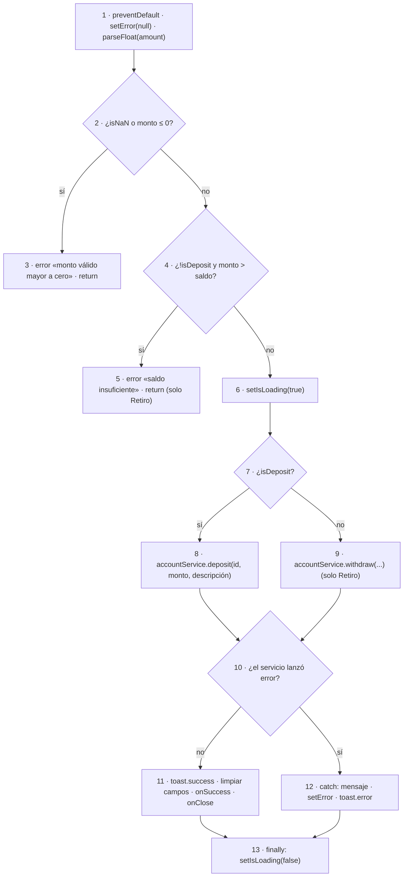

# Pruebas unitarias de caja blanca — Módulo Bolsillos y Depositar (Frontend)

Casos derivados de las **tablas de camino** del diagrama `Frontend.drawio`.
Cada caso corresponde a una fila de la tabla de una de las cinco hojas del diagrama:
se declara la secuencia de nodos, las condiciones que hay que forzar en cada decisión,
las entradas concretas que lo consiguen, el resultado esperado y el resultado obtenido
al ejecutar el handler real con el servicio HTTP, la API de toasts y el estado de React
sustituidos por dobles.

La sexta funcionalidad, **Depositar dinero** (módulo Cuentas), se agregó el 2026-10-26 con la
misma técnica. `Frontend.drawio` no tiene una hoja para ella y su lógica no está en un archivo de
handlers sino dentro del componente `DepositWithdrawModal`, así que se ejercita renderizando el
modal real en jsdom; sus nodos se numeran en la sección [Depositar dinero](#depositar-dinero).

| | Bolsillos (5 funcionalidades) | Depositar dinero |
| --- | --- | --- |
| **Fecha de ejecución** | 2026-08-25 | 2026-10-26 |
| **Versión probada** | main-04800eb | rama `tests/bolsillos-katalon` @ df760a8 (la prueba aún no está commiteada) |
| **Entorno** | Frontend (Node + tsx), sin DOM ni red | Frontend (Vitest + jsdom + Testing Library), sin red |
| **Unidad bajo prueba** | `src/features/pockets/handlers/pocket.handlers.ts` | `handleSubmit` de `src/features/account/components/DepositWithdrawModal.tsx` (modo `deposit`) |
| **Cómo reproducir** | `npm run test:paths` desde `frontend/` (runner `tsx` legacy: el script ya no figura en `package.json`) | `npx vitest run src/tests/unit/account/DepositWithdrawModal.paths.test.tsx` desde `frontend/` |

- **Técnica:** prueba de caminos básicos (McCabe) sobre los handlers del módulo Bolsillos

## Resumen

| Funcionalidad | Caminos probados | Aprobados | Fallidos | No ejecutables |
| --- | ---: | ---: | ---: | ---: |
| Crear bolsillo | 4 | 4 | 0 | 0 |
| Actualizar bolsillo | 3 | 3 | 0 | 0 |
| Eliminar bolsillo | 3 | 3 | 0 | 0 |
| Transferir entre bolsillos | 4 | 4 | 0 | 0 |
| Consultar bolsillos | 3 | 3 | 0 | 0 |
| Depositar dinero (Cuentas) | 9 | 7 | 0 | 2 |
| **Total** | **26** | **24** | **0** | **2** |

## Índice de casos

| ID | Funcionalidad | Camino | Secuencia | Estado |
| --- | --- | --- | --- | --- |
| FE-CR-C1 | Crear bolsillo | Camino 1 | `1 → 3 → Fin` | ✅ Aprobado |
| FE-CR-C1b | Crear bolsillo | Camino 1 (segunda cláusula de la condición) | `1 → 3 → Fin` | ✅ Aprobado |
| FE-CR-C2 | Crear bolsillo | Camino 2 | `1 → 2 → 4 → 6 → 8 → 9 → Fin` | ✅ Aprobado |
| FE-CR-C3 | Crear bolsillo | Camino 3 | `1 → 2 → 4 → 5 → 7 → 9 → Fin` | ✅ Aprobado |
| FE-AC-C1 | Actualizar bolsillo | Camino 1 | `1 → 3 → Fin` | ✅ Aprobado |
| FE-AC-C2 | Actualizar bolsillo | Camino 2 | `1 → 2 → 4 → 5 → 7 → 9 → 10 → Fin` | ✅ Aprobado |
| FE-AC-C3 | Actualizar bolsillo | Camino 3 | `1 → 2 → 4 → 5 → 6 → 8 → 10 → Fin` | ✅ Aprobado |
| FE-EL-C1 | Eliminar bolsillo | Camino 1 | `1 → 3 → Fin` | ✅ Aprobado |
| FE-EL-C2 | Eliminar bolsillo | Camino 2 | `1 → 2 → 4 → 5 → 7 → 9 → 10 → Fin` | ✅ Aprobado |
| FE-EL-C3 | Eliminar bolsillo | Camino 3 | `1 → 2 → 4 → 5 → 6 → 8 → 10 → Fin` | ✅ Aprobado |
| FE-TR-C1 | Transferir entre bolsillos | Camino 1 | `1 → 3 → Fin` | ✅ Aprobado |
| FE-TR-C1b | Transferir entre bolsillos | Camino 1 (tercera cláusula de la condición) | `1 → 3 → Fin` | ✅ Aprobado |
| FE-TR-C2 | Transferir entre bolsillos | Camino 2 | `1 → 2 → 4 → 5 → 7 → 9 → 10 → Fin` | ✅ Aprobado |
| FE-TR-C3 | Transferir entre bolsillos | Camino 3 | `1 → 2 → 4 → 5 → 6 → 8 → 10 → Fin` | ✅ Aprobado |
| FE-CO-C1 | Consultar bolsillos | Camino 1 | `1 → 2 → 3 → 5 → 6 → 7 → Fin` | ✅ Aprobado |
| FE-CO-C2 | Consultar bolsillos | Camino 2 | `1 → 2 → 3 → 4 → 7 → Fin` | ✅ Aprobado |
| FE-CO-C1b | Consultar bolsillos | Camino 1 (mensaje de respaldo, no tabulado) | `1 → 2 → 3 → 5 → 6 → 7 → Fin` | ✅ Aprobado |
| FE-DE-C1 | Depositar dinero | Camino 1 (monto 0) | `1 → 2 → 3 → Fin` | ✅ Aprobado |
| FE-DE-C1b | Depositar dinero | Camino 1 (monto negativo) | `1 → 2 → 3 → Fin` | ✅ Aprobado |
| FE-DE-C1c | Depositar dinero | Camino 1 (monto vacío → NaN, primera cláusula) | `1 → 2 → 3 → Fin` | ✅ Aprobado |
| FE-DE-C2 | Depositar dinero | Camino 2 (saldo insuficiente, solo Retiro) | `1 → 2 → 4 → 5 → Fin` | ⚠️ No ejecutable |
| FE-DE-C3 | Depositar dinero | Camino 3 (el servicio lanza error) | `1 → 2 → 4 → 6 → 7 → 8 → 10 → 12 → 13 → Fin` | ✅ Aprobado |
| FE-DE-C3b | Depositar dinero | Camino 3 (error sin `message`, texto de respaldo) | `1 → 2 → 4 → 6 → 7 → 8 → 10 → 12 → 13 → Fin` | ✅ Aprobado |
| FE-DE-C4 | Depositar dinero | Camino 4 (depósito correcto) | `1 → 2 → 4 → 6 → 7 → 8 → 10 → 11 → 13 → Fin` | ✅ Aprobado |
| FE-DE-C4b | Depositar dinero | Camino 4 (descripción vacía) | `1 → 2 → 4 → 6 → 7 → 8 → 10 → 11 → 13 → Fin` | ✅ Aprobado |
| FE-DE-C5 | Depositar dinero | Camino 5 (retiro correcto, solo Retiro) | `1 → 2 → 4 → 6 → 7 → 9 → 10 → 11 → 13 → Fin` | ⚠️ No ejecutable |

## Crear bolsillo

Función bajo prueba: `handleCreate()`

### FE-CR-C1 — Camino 1

| Campo | Contenido |
| --- | --- |
| **Secuencia de nodos** | `1 → 3 → Fin` |
| **Condiciones forzadas** | • N1 (!accountId \|\| !name) = VERDADERO — no hay cuenta seleccionada |
| **Entradas** | • Formulario con la cuenta sin seleccionar • input = { accountId: "", name: "Vacaciones", amount: "300" } |
| **Resultado esperado** | Se muestra el toast de advertencia "Falta información" y la función retorna en el nodo 3: no se llama al servicio ni se activa el indicador de carga. |
| **Resultado obtenido** | Toast warning · "Falta información" — "Selecciona una cuenta y escribe el nombre del bolsillo." · llamadas a pocketService.create: 0 · setLoading invocado 0 veces (nodos 2 y 9 no recorridos) |
| **Estado** | ✅ **Aprobado** |

### FE-CR-C1b — Camino 1 (segunda cláusula de la condición)

| Campo | Contenido |
| --- | --- |
| **Secuencia de nodos** | `1 → 3 → Fin` |
| **Condiciones forzadas** | • N1 (!accountId \|\| !name) = VERDADERO — por !name, con accountId presente |
| **Entradas** | • Cuenta seleccionada correctamente • input = { accountId: "account-1", name: "", amount: "300" } |
| **Resultado esperado** | La segunda cláusula de la condición compuesta también corta el flujo en el nodo 3 con el mismo toast de advertencia. |
| **Resultado obtenido** | Toast warning · "Falta información" — "Selecciona una cuenta y escribe el nombre del bolsillo." · cláusula activada: !name · llamadas al servicio: 0 |
| **Estado** | ✅ **Aprobado** |

### FE-CR-C2 — Camino 2

| Campo | Contenido |
| --- | --- |
| **Secuencia de nodos** | `1 → 2 → 4 → 6 → 8 → 9 → Fin` |
| **Condiciones forzadas** | • N1 (!accountId \|\| !name) = FALSO • N4 (¿pocketService.create lanzó error?) = VERDADERO |
| **Entradas** | • Formulario completo: input = { accountId: "account-1", name: "Vacaciones", amount: "300" } • pocketService.create rechaza con { message: "No tienes saldo disponible suficiente para crear este bolsillo" } (respuesta del backend) |
| **Resultado esperado** | El catch (nodo 6) toma el mensaje del backend, el nodo 8 lo muestra en un toast de error, el finally (nodo 9) apaga el indicador de carga y la lista de bolsillos no cambia. |
| **Resultado obtenido** | Toast error · "No fue posible crear el bolsillo" — "No tienes saldo disponible suficiente para crear este bolsillo" · mensaje del backend propagado · bolsillos en la lista: 0 · setLoading: [true, false] |
| **Estado** | ✅ **Aprobado** |

### FE-CR-C3 — Camino 3

| Campo | Contenido |
| --- | --- |
| **Secuencia de nodos** | `1 → 2 → 4 → 5 → 7 → 9 → Fin` |
| **Condiciones forzadas** | • N1 = FALSO • N4 (¿lanzó error?) = FALSO |
| **Entradas** | • Lista con un bolsillo previo "Laptop" ($200) • input = { accountId: "account-1", name: "Vacaciones", amount: "300" } • pocketService.create resuelve con el bolsillo "Vacaciones" de $300 |
| **Resultado esperado** | El nodo 5 antepone el bolsillo creado a la lista y limpia los campos del formulario, el nodo 7 muestra el toast "Bolsillo creado" y el finally (nodo 9) apaga el indicador de carga. |
| **Resultado obtenido** | Bolsillo "Vacaciones" ($300) antepuesto a la lista — ahora 2 bolsillos · campos limpiados (name="", amount="") · toast success · "Bolsillo creado" — "Tu ahorro quedó organizado correctamente." · setLoading: [true, false] |
| **Estado** | ✅ **Aprobado** |

## Actualizar bolsillo

Función bajo prueba: `handleSaveEdit()`

### FE-AC-C1 — Camino 1

| Campo | Contenido |
| --- | --- |
| **Secuencia de nodos** | `1 → 3 → Fin` |
| **Condiciones forzadas** | • N1 (!editingName.trim()) = VERDADERO |
| **Entradas** | • Bolsillo "Vacaciones" ($300) en modo edición • input = { pocketId: "pocket-1", editingName: "   ", editingAmount: "300" } — nombre de solo espacios |
| **Resultado esperado** | Se muestra el toast de advertencia "Nombre inválido" y la función retorna en el nodo 3: no se llama al servicio ni se sale del modo edición. |
| **Resultado obtenido** | Toast warning · "Nombre inválido" — "El nombre del bolsillo no puede quedar vacío." · entrada editingName = "   " (longitud tras trim = 0) · llamadas a pocketService.update: 0 · sigue en edición (editingPocketId = "pocket-1") |
| **Estado** | ✅ **Aprobado** |

### FE-AC-C2 — Camino 2

| Campo | Contenido |
| --- | --- |
| **Secuencia de nodos** | `1 → 2 → 4 → 5 → 7 → 9 → 10 → Fin` |
| **Condiciones forzadas** | • N1 = FALSO • N5 (¿pocketService.update lanzó error?) = VERDADERO |
| **Entradas** | • Bolsillo "Vacaciones" ($300) en modo edición • input = { pocketId: "pocket-1", editingName: "Viaje a la costa", editingAmount: "1500" } • pocketService.update rechaza con { message: "No tienes saldo disponible suficiente para ajustar este bolsillo" } |
| **Resultado esperado** | El catch (nodo 7) toma el mensaje del backend, el nodo 9 lo muestra en un toast de error, el finally (nodo 10) apaga el indicador de carga y se permanece en modo edición con el bolsillo sin cambios. |
| **Resultado obtenido** | Toast error · "No fue posible actualizar el bolsillo" — "No tienes saldo disponible suficiente para ajustar este bolsillo" · el bolsillo conserva nombre "Vacaciones" y monto $300 · sigue en edición · setLoading: [true, false] |
| **Estado** | ✅ **Aprobado** |

### FE-AC-C3 — Camino 3

| Campo | Contenido |
| --- | --- |
| **Secuencia de nodos** | `1 → 2 → 4 → 5 → 6 → 8 → 10 → Fin` |
| **Condiciones forzadas** | • N1 = FALSO • N5 (¿lanzó error?) = FALSO |
| **Entradas** | • Lista con dos bolsillos: "Vacaciones" ($300, en edición) y "Laptop" ($200) • input = { pocketId: "pocket-1", editingName: "  Viaje a la costa  ", editingAmount: "500" } • pocketService.update resuelve con el bolsillo actualizado |
| **Resultado esperado** | El nombre se envía recortado con trim() y el monto convertido a número; el nodo 6 reemplaza el bolsillo en la lista y sale del modo edición, el nodo 8 muestra "Bolsillo actualizado" y el finally (nodo 10) apaga el indicador de carga. |
| **Resultado obtenido** | Enviado al servicio { name: "Viaje a la costa", amount: 500 } (trim aplicado) · lista actualizada: "Viaje a la costa" $500, "Laptop" intacto · modo edición cerrado (editingPocketId = null) · toast success · "Bolsillo actualizado" — "Los cambios quedaron guardados." |
| **Estado** | ✅ **Aprobado** |

## Eliminar bolsillo

Función bajo prueba: `confirmDelete()`

### FE-EL-C1 — Camino 1

| Campo | Contenido |
| --- | --- |
| **Secuencia de nodos** | `1 → 3 → Fin` |
| **Condiciones forzadas** | • N1 (!pendingDeletePocket) = VERDADERO |
| **Entradas** | • Lista con un bolsillo "Vacaciones" ($300) • pendingDeletePocket = null — se confirma sin que haya un bolsillo marcado para eliminar |
| **Resultado esperado** | La función retorna de inmediato en el nodo 3: no se llama al servicio, no se emite ningún toast y la lista no cambia. |
| **Resultado obtenido** | Retorno inmediato sin efectos · toasts emitidos: 0 · llamadas a pocketService.remove: 0 · bolsillos en la lista: 1 (sin cambios) |
| **Estado** | ✅ **Aprobado** |

### FE-EL-C2 — Camino 2

| Campo | Contenido |
| --- | --- |
| **Secuencia de nodos** | `1 → 2 → 4 → 5 → 7 → 9 → 10 → Fin` |
| **Condiciones forzadas** | • N1 = FALSO • N5 (¿pocketService.remove lanzó error?) = VERDADERO |
| **Entradas** | • Lista con un bolsillo "Vacaciones" ($300) • pendingDeletePocket = ese bolsillo • pocketService.remove rechaza con { message: "La cuenta no está disponible para eliminar bolsillos" } |
| **Resultado esperado** | El catch (nodo 7) toma el mensaje del backend, el nodo 9 lo muestra en un toast de error, el bolsillo permanece en la lista y el finally (nodo 10) apaga el indicador de carga y cierra el modal. |
| **Resultado obtenido** | Toast error · "No fue posible eliminar el bolsillo" — "La cuenta no está disponible para eliminar bolsillos" · el bolsillo "Vacaciones" sigue en la lista · modal cerrado (pendingDeletePocket = null) · setLoading: [true, false] |
| **Estado** | ✅ **Aprobado** |

### FE-EL-C3 — Camino 3

| Campo | Contenido |
| --- | --- |
| **Secuencia de nodos** | `1 → 2 → 4 → 5 → 6 → 8 → 10 → Fin` |
| **Condiciones forzadas** | • N1 = FALSO • N5 (¿lanzó error?) = FALSO |
| **Entradas** | • Lista con dos bolsillos: "Vacaciones" ($300) y "Laptop" ($200) • pendingDeletePocket = "Vacaciones" • pocketService.remove resuelve correctamente |
| **Resultado esperado** | El nodo 6 quita el bolsillo de la lista dejando solo "Laptop", el nodo 8 muestra "Bolsillo eliminado" y el finally (nodo 10) apaga el indicador de carga y cierra el modal. |
| **Resultado obtenido** | Bolsillo "Vacaciones" ($300) retirado de la lista — queda "Laptop" · toast success · "Bolsillo eliminado" — "El saldo volvió a la cuenta correctamente." · modal cerrado · setLoading: [true, false] |
| **Estado** | ✅ **Aprobado** |

## Transferir entre bolsillos

Función bajo prueba: `handleTransfer()`

### FE-TR-C1 — Camino 1

| Campo | Contenido |
| --- | --- |
| **Secuencia de nodos** | `1 → 3 → Fin` |
| **Condiciones forzadas** | • N1 (!fromPocketId \|\| !toPocketId \|\| !transferAmount) = VERDADERO — no se eligió bolsillo destino |
| **Entradas** | • Formulario de transferencia incompleto • input = { fromPocketId: "pocket-1", toPocketId: "", transferAmount: "120" } |
| **Resultado esperado** | Se muestra el toast de advertencia "Falta información" y la función retorna en el nodo 3: no se llama al servicio ni se recarga la lista. |
| **Resultado obtenido** | Toast warning · "Falta información" — "Selecciona los bolsillos y un monto para transferir." · cláusula activada: !toPocketId · llamadas a pocketService.transfer: 0 · recargas de la lista: 0 |
| **Estado** | ✅ **Aprobado** |

### FE-TR-C1b — Camino 1 (tercera cláusula de la condición)

| Campo | Contenido |
| --- | --- |
| **Secuencia de nodos** | `1 → 3 → Fin` |
| **Condiciones forzadas** | • N1 = VERDADERO — por !transferAmount, con ambos bolsillos elegidos |
| **Entradas** | • Ambos bolsillos seleccionados pero el monto vacío • input = { fromPocketId: "pocket-1", toPocketId: "pocket-2", transferAmount: "" } |
| **Resultado esperado** | La tercera cláusula de la condición compuesta también corta el flujo en el nodo 3 con el mismo toast de advertencia. |
| **Resultado obtenido** | Toast warning · "Falta información" — "Selecciona los bolsillos y un monto para transferir." · cláusula activada: !transferAmount · llamadas al servicio: 0 |
| **Estado** | ✅ **Aprobado** |

### FE-TR-C2 — Camino 2

| Campo | Contenido |
| --- | --- |
| **Secuencia de nodos** | `1 → 2 → 4 → 5 → 7 → 9 → 10 → Fin` |
| **Condiciones forzadas** | • N1 = FALSO • N5 (¿pocketService.transfer lanzó error?) = VERDADERO |
| **Entradas** | • input = { fromPocketId: "pocket-1", toPocketId: "pocket-2", transferAmount: "500" } • pocketService.transfer rechaza con { message: "Saldo insuficiente en el bolsillo de origen" } |
| **Resultado esperado** | El catch (nodo 7) toma el mensaje del backend, el nodo 9 lo muestra en un toast de error, NO se recarga la lista (nodo 8 no recorrido) y el finally (nodo 10) apaga el indicador de carga. |
| **Resultado obtenido** | Toast error · "No fue posible transferir el saldo" — "Saldo insuficiente en el bolsillo de origen" · recargas de la lista: 0 · setLoading: [true, false] |
| **Estado** | ✅ **Aprobado** |

### FE-TR-C3 — Camino 3

| Campo | Contenido |
| --- | --- |
| **Secuencia de nodos** | `1 → 2 → 4 → 5 → 6 → 8 → 10 → Fin` |
| **Condiciones forzadas** | • N1 = FALSO • N5 (¿lanzó error?) = FALSO |
| **Entradas** | • input = { fromPocketId: "pocket-1", toPocketId: "pocket-2", transferAmount: "120" } • pocketService.transfer resuelve con { fromPocket: "Origen" $180, toPocket: "Destino" $220 } |
| **Resultado esperado** | El monto se envía convertido a número; el nodo 6 muestra el toast "Transferencia realizada" con los nombres origen → destino y el nodo 8 recarga la lista llamando a loadPockets(). El finally (nodo 10) apaga el indicador de carga. |
| **Resultado obtenido** | Enviado al servicio { from: "pocket-1", to: "pocket-2", amount: 120 } · toast success · "Transferencia realizada" — "Origen → Destino" · resultado $180 / $220 · loadPockets() invocado 1 vez · setLoading: [true, false] |
| **Estado** | ✅ **Aprobado** |

## Consultar bolsillos

Función bajo prueba: `loadPockets()`

### FE-CO-C1 — Camino 1

| Campo | Contenido |
| --- | --- |
| **Secuencia de nodos** | `1 → 2 → 3 → 5 → 6 → 7 → Fin` |
| **Condiciones forzadas** | • N3 (¿pocketService.getByAccount lanzó error?) = VERDADERO |
| **Entradas** | • accountId = "account-1" • pocketService.getByAccount rechaza con { message: "No tienes permiso para acceder a esta cuenta" } |
| **Resultado esperado** | El catch (nodo 5) toma el mensaje del backend, el nodo 6 lo muestra en un toast de error, la lista de bolsillos no se toca (nodo 4 no recorrido) y el finally (nodo 7) apaga el indicador de carga. |
| **Resultado obtenido** | Toast error · "No fue posible cargar los bolsillos" — "No tienes permiso para acceder a esta cuenta" · la lista conserva 1 bolsillo ("Laptop") · setLoading: [true, false] |
| **Estado** | ✅ **Aprobado** |

### FE-CO-C2 — Camino 2

| Campo | Contenido |
| --- | --- |
| **Secuencia de nodos** | `1 → 2 → 3 → 4 → 7 → Fin` |
| **Condiciones forzadas** | • N3 (¿lanzó error?) = FALSO |
| **Entradas** | • accountId = "account-1" • pocketService.getByAccount resuelve con dos bolsillos: "Vacaciones" ($300) y "Laptop" ($200) |
| **Resultado esperado** | El nodo 4 reemplaza la lista con los datos recibidos, no se emite ningún toast y el finally (nodo 7) apaga el indicador de carga. |
| **Resultado obtenido** | Lista cargada con 2 bolsillos: "Vacaciones" ($300), "Laptop" ($200) · toasts emitidos: 0 · setLoading: [true, false] |
| **Estado** | ✅ **Aprobado** |

### FE-CO-C1b — Camino 1 (mensaje de respaldo, no tabulado)

| Campo | Contenido |
| --- | --- |
| **Secuencia de nodos** | `1 → 2 → 3 → 5 → 6 → 7 → Fin` |
| **Condiciones forzadas** | • N3 (¿lanzó error?) = VERDADERO • El error no trae `message` ni `error.message`: se usa el texto de respaldo del nodo 5 |
| **Entradas** | • accountId = "account-1" • pocketService.getByAccount rechaza con un objeto vacío {} (por ejemplo, una caída de red sin cuerpo) |
| **Resultado esperado** | El nodo 5 recurre al mensaje de respaldo "No fue posible cargar los bolsillos." y el nodo 6 lo muestra como descripción del toast de error. |
| **Resultado obtenido** | Toast error · "No fue posible cargar los bolsillos" — "No fue posible cargar los bolsillos." · se aplicó el texto de respaldo del nodo 5 |
| **Estado** | ✅ **Aprobado** |

## Depositar dinero

Función bajo prueba: `handleSubmit()` de `DepositWithdrawModal` en modo `deposit`

Prueba: `frontend/src/tests/unit/account/DepositWithdrawModal.paths.test.tsx`. El modal real se
renderiza en jsdom con `accountService` y `useToast` sustituidos por dobles; el formulario se envía con
`fireEvent.submit`, que evita la validación nativa `required` (en un navegador real esa validación frena
el monto vacío antes de llegar a `handleSubmit`, ver Katalon TC-150).

### Grafo de flujo

| Nodo | Tipo | Sentencia de `DepositWithdrawModal.tsx` |
| ---: | --- | --- |
| 1 | Proceso | `e.preventDefault(); setError(null); const numericAmount = Number.parseFloat(amount)` |
| 2 | Decisión | `Number.isNaN(numericAmount) \|\| numericAmount <= 0` |
| 3 | Proceso | `setError('Por favor ingresa un monto válido mayor a cero.'); return` |
| 4 | Decisión | `!isDeposit && numericAmount > account.balance` |
| 5 | Proceso | `setError('Saldo insuficiente en la cuenta para realizar este retiro.'); return` |
| 6 | Proceso | `setIsLoading(true)` |
| 7 | Decisión | `isDeposit` |
| 8 | Proceso | `await accountService.deposit(account.id, numericAmount, description)` |
| 9 | Proceso | `await accountService.withdraw(account.id, numericAmount, description)` |
| 10 | Decisión | ¿el `try` lanzó error? (`catch`) |
| 11 | Proceso | `toast.success(...)`, `setAmount('')`, `setDescription('')`, `onSuccess()`, `onClose()` |
| 12 | Proceso | catch: `message` del error o texto de respaldo, `setError(message)`, `toast.error(...)` |
| 13 | Proceso | `finally { setIsLoading(false) }` |

**V(G) = 4 decisiones (nodos 2, 4, 7 y 10) + 1 = 5** caminos independientes. El modal se comparte con Retiro:
en modo `deposit` la decisión 4 es siempre FALSA y la 7 siempre VERDADERA, de modo que los nodos 5 y 9 son
inalcanzables. Esos dos caminos (FE-DE-C2 y FE-DE-C5) se registran como **no ejecutables** y la prueba lo
demuestra; su cobertura corresponde a la funcionalidad Retiro.

### FE-DE-C1 — Camino 1

| Campo | Contenido |
| --- | --- |
| **Secuencia de nodos** | `1 → 2 → 3 → Fin` |
| **Condiciones forzadas** | • N2 (Number.isNaN(monto) \|\| monto <= 0) = VERDADERO — por la segunda cláusula (monto <= 0) |
| **Entradas** | • Modal de depósito abierto sobre la cuenta "acc-1" (saldo $1.000.000) • input = { amount: "0", description: "" } • Valor límite: monto = 0 (el mínimo válido es mayor que cero) |
| **Resultado esperado** | Se muestra el mensaje "Por favor ingresa un monto válido mayor a cero." y la función retorna en el nodo 3: no se llama al servicio, no se emite ningún toast ni se activa el indicador de carga. |
| **Resultado obtenido** | Banner `dw-error` · "Por favor ingresa un monto válido mayor a cero." · llamadas a accountService.deposit: 0 · toasts emitidos: 0 · onSuccess y onClose: 0 · botón habilitado con la etiqueta "Abonar Saldo" (nodos 6 y 13 no recorridos) |
| **Estado** | ✅ **Aprobado** |

### FE-DE-C1b — Camino 1 (monto negativo)

| Campo | Contenido |
| --- | --- |
| **Secuencia de nodos** | `1 → 2 → 3 → Fin` |
| **Condiciones forzadas** | • N2 = VERDADERO — por la segunda cláusula, con monto negativo |
| **Entradas** | • input = { amount: "-50000", description: "" } |
| **Resultado esperado** | El monto negativo también corta el flujo en el nodo 3 con el mismo mensaje. |
| **Resultado obtenido** | Banner `dw-error` · "Por favor ingresa un monto válido mayor a cero." · llamadas al servicio: 0 · toasts emitidos: 0 · botón habilitado |
| **Estado** | ✅ **Aprobado** |

### FE-DE-C1c — Camino 1 (monto vacío → NaN, primera cláusula)

| Campo | Contenido |
| --- | --- |
| **Secuencia de nodos** | `1 → 2 → 3 → Fin` |
| **Condiciones forzadas** | • N2 = VERDADERO — por la primera cláusula: parseFloat("") = NaN |
| **Entradas** | • input = { amount: "", description: "" } enviado con `fireEvent.submit` (sin la validación nativa `required`) |
| **Resultado esperado** | La primera cláusula de la condición compuesta también corta el flujo en el nodo 3 con el mismo mensaje. |
| **Resultado obtenido** | Banner `dw-error` · "Por favor ingresa un monto válido mayor a cero." · llamadas al servicio: 0 · toasts emitidos: 0 · botón habilitado |
| **Estado** | ✅ **Aprobado** |

### FE-DE-C2 — Camino 2 (saldo insuficiente, solo Retiro)

| Campo | Contenido |
| --- | --- |
| **Secuencia de nodos** | `1 → 2 → 4 → 5 → Fin` |
| **Condiciones forzadas** | • N4 (!isDeposit && monto > saldo) = VERDADERO exigiría `isDeposit = false` |
| **Entradas** | • Para comprobar que no es alcanzable: depósito de $5.000.000 sobre una cuenta con saldo $1.000.000 (monto mayor al saldo) |
| **Resultado esperado** | En modo depósito la primera cláusula de N4 (!isDeposit) es FALSA, así que el monto mayor al saldo no se rechaza y el flujo sigue al nodo 6. |
| **Resultado obtenido** | El depósito se envió: accountService.deposit invocado 1 vez con ("acc-1", 5000000, "") · no apareció ningún banner de error (nodo 5 inalcanzable) |
| **Estado** | ⚠️ **No ejecutable** en modo depósito — el camino pertenece a Retiro |

### FE-DE-C3 — Camino 3 (el servicio lanza error)

| Campo | Contenido |
| --- | --- |
| **Secuencia de nodos** | `1 → 2 → 4 → 6 → 7 → 8 → 10 → 12 → 13 → Fin` |
| **Condiciones forzadas** | • N2 = FALSO • N4 = FALSO • N7 (isDeposit) = VERDADERO • N10 (¿lanzó error?) = VERDADERO, con un error que trae `message` |
| **Entradas** | • input = { amount: "150000", description: "Ahorro mensual" } • accountService.deposit rechaza con { message: "La cuenta no está activa" } (respuesta del backend) |
| **Resultado esperado** | El catch (nodo 12) toma el mensaje del backend, lo muestra en el banner y en un toast de error; no se llama a onSuccess ni a onClose, el formulario conserva lo escrito y el finally (nodo 13) apaga el indicador de carga. |
| **Resultado obtenido** | Banner `dw-error` · "La cuenta no está activa" · toast error · "No pudimos completar la operacion" — "La cuenta no está activa" · toast success: 0 · onSuccess y onClose: 0 · el campo monto conserva "150000" · botón habilitado con la etiqueta "Abonar Saldo" |
| **Estado** | ✅ **Aprobado** |

### FE-DE-C3b — Camino 3 (error sin `message`, texto de respaldo)

| Campo | Contenido |
| --- | --- |
| **Secuencia de nodos** | `1 → 2 → 4 → 6 → 7 → 8 → 10 → 12 → 13 → Fin` |
| **Condiciones forzadas** | • N10 = VERDADERO • El error no es un objeto con `message`: se usa el texto de respaldo del nodo 12 |
| **Entradas** | • input = { amount: "150000" } • accountService.deposit rechaza con la cadena "fallo de red" (no es un objeto) |
| **Resultado esperado** | El nodo 12 recurre al mensaje de respaldo "Error al procesar la transaccion" en el banner y en el toast. |
| **Resultado obtenido** | Banner `dw-error` · "Error al procesar la transaccion" · toast error · "No pudimos completar la operacion" — "Error al procesar la transaccion" |
| **Estado** | ✅ **Aprobado** |

### FE-DE-C4 — Camino 4 (depósito correcto)

| Campo | Contenido |
| --- | --- |
| **Secuencia de nodos** | `1 → 2 → 4 → 6 → 7 → 8 → 10 → 11 → 13 → Fin` |
| **Condiciones forzadas** | • N2 = FALSO • N4 = FALSO • N7 = VERDADERO • N10 (¿lanzó error?) = FALSO |
| **Entradas** | • input = { amount: "150000", description: "Ahorro mensual" } • accountService.deposit devuelve una promesa pendiente que se resuelve después, con la cuenta en $1.150.000 |
| **Resultado esperado** | Mientras el servicio responde (nodo 6) el botón queda bloqueado como "Procesando..."; al resolver, el nodo 11 muestra el toast de éxito, limpia los campos y llama a onSuccess y a onClose, y el finally (nodo 13) apaga la carga. |
| **Resultado obtenido** | Durante la espera: botón deshabilitado · "Procesando..." · enviado al servicio ("acc-1", 150000, "Ahorro mensual") · tras resolver: toast success · "Deposito realizado" — "Cuenta ****1234 actualizada correctamente." · campos monto y descripción vacíos · onSuccess 1 vez · onClose 1 vez · sin banner de error · botón habilitado con la etiqueta "Abonar Saldo" |
| **Estado** | ✅ **Aprobado** |

### FE-DE-C4b — Camino 4 (descripción vacía)

| Campo | Contenido |
| --- | --- |
| **Secuencia de nodos** | `1 → 2 → 4 → 6 → 7 → 8 → 10 → 11 → 13 → Fin` |
| **Condiciones forzadas** | • Las mismas del camino 4, sin escribir la descripción (campo opcional) |
| **Entradas** | • input = { amount: "50000", description: "" } • accountService.deposit resuelve con la cuenta en $1.050.000 |
| **Resultado esperado** | El depósito se realiza sin descripción. |
| **Resultado obtenido** | Enviado al servicio ("acc-1", 50000, "") — la descripción viaja como cadena vacía, no como `undefined` · onClose invocado 1 vez |
| **Estado** | ✅ **Aprobado** |

### FE-DE-C5 — Camino 5 (retiro correcto, solo Retiro)

| Campo | Contenido |
| --- | --- |
| **Secuencia de nodos** | `1 → 2 → 4 → 6 → 7 → 9 → 10 → 11 → 13 → Fin` |
| **Condiciones forzadas** | • N7 (isDeposit) = FALSO exigiría `type = "withdraw"` |
| **Entradas** | • Para comprobar que no es alcanzable: depósito de $100.000 sobre la cuenta "acc-1" |
| **Resultado esperado** | En modo depósito el nodo 7 siempre es VERDADERO, así que el nodo 9 no se recorre. |
| **Resultado obtenido** | El depósito se completó (onClose 1 vez) · accountService.withdraw invocado 0 veces (nodo 9 inalcanzable) |
| **Estado** | ⚠️ **No ejecutable** en modo depósito — el camino pertenece a Retiro |

## Hallazgos

Todos los caminos ejecutados terminaron en el nodo esperado. En Depositar quedan dos caminos no ejecutables (FE-DE-C2 y FE-DE-C5) porque el modal es compartido con Retiro; no son un defecto, pero esa parte del grafo solo se cubre probando el modo `withdraw`.

---

_Los caminos de Bolsillos provienen de `npm run test:paths` (runner legacy); los de Depositar, de `DepositWithdrawModal.paths.test.tsx` (Vitest). En ambos casos el resultado obtenido proviene de la ejecución real del handler, no de una transcripción manual._
