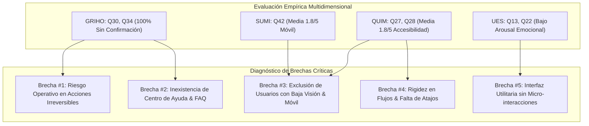

# PLAN DE PRUEBAS
## Evaluación Psicométrica de Usabilidad, Experiencia Afectiva, Compromiso e Inspección Heurística del Sistema Web FUBANK

---

**Proyecto:** FUBANK  
**Versión:** 2.0  
**Fecha:** 13/10/2026  
**Equipo de Pruebas:**  
Andres Bedoya  
Dubin Andres Soto  
Tomas Henao  
Stiven Alejandro Bustamante  

**Institución:** Universidad / Facultad de Ingeniería de Sistemas  
**Asignatura:** Validación y Verificación de Software 
**Lugar:** Medellín, Colombia  

---

## Tabla de Contenido

- [1. Resumen Ejecutivo](#1-resumen-ejecutivo)
- [2. Introducción y Contexto del Proyecto](#2-introducción-y-contexto-del-proyecto)
- [3. Marco Teórico y Psicométrico de Evaluación](#3-marco-teórico-y-psicométrico-de-evaluación)
  - [3.1. Modelo de Calidad en Uso QUIM (Seffah et al., 2006)](#31-modelo-de-calidad-en-uso-quim-seffah-et-al-2006)
  - [3.2. Modelo de Evaluación Afectiva SAM (Bradley & Lang, 1994)](#32-modelo-de-evaluación-afectiva-sam-bradley--lang-1994)
  - [3.3. Cuestionario de Medición de Usabilidad SUMI (Kirakowski & Corbett, 1993)](#33-cuestionario-de-medición-de-usabilidad-sumi-kirakowski--corbett-1993)
  - [3.4. Escala de Compromiso del Usuario UES (O'Brien et al., 2018)](#34-escala-de-compromiso-del-usuario-ues-obrien-et-al-2018)
  - [3.5. Inspección Heurística de Usabilidad — Pauta GRIHO (Nielsen, 1994; Granollers, 2004)](#35-inspección-heurística-de-usabilidad--pauta-griho-nielsen-1994-granollers-2004)
- [4. Metodología de Muestreo y Recolección de Datos](#4-metodología-de-muestreo-y-recolección-de-datos)
  - [4.1. Caracterización de la Muestra ($N = 20$)](#41-caracterización-de-la-muestra-n--20)
  - [4.2. Instrumentos y Protocolo de Administración](#42-instrumentos-y-protocolo-de-administración)
- [5. Resultados Estadísticos Consolidados](#5-resultados-estadísticos-consolidados)
  - [5.1. Resultados del Cuestionario QUIM](#51-resultados-del-cuestionario-quim)
  - [5.2. Resultados del Cuestionario SAM](#52-resultados-del-cuestionario-sam)
  - [5.3. Resultados del Cuestionario SUMI](#53-resultados-del-cuestionario-sumi)
  - [5.4. Resultados de la Escala UES](#54-resultados-de-la-escala-ues)
  - [5.5. Resultados de la Inspección Heurística GRIHO](#55-resultados-de-la-inspección-heurística-griho)
- [6. Diagnóstico Crítico Transversal y Análisis de Brechas](#6-diagnóstico-crítico-transversal-y-análisis-de-brechas)
  - [6.1. Brecha #1: Ausencia de Prevención y Confirmación ante Acciones Irreversibles (Severidad 4)](#61-brecha-1-ausencia-de-prevención-y-confirmación-ante-acciones-irreversibles-severidad-4)
  - [6.2. Brecha #2: Inexistencia de Centro de Ayuda Contextual y FAQ (Severidad 3)](#62-brecha-2-inexistencia-de-centro-de-ayuda-contextual-y-faq-severidad-3)
  - [6.3. Brecha #3: Deficiencias en Accesibilidad WCAG 2.1 AA y Adaptabilidad Móvil (Severidad 3)](#63-brecha-3-deficiencias-en-accesibilidad-wcag-21-aa-y-adaptabilidad-móvil-severidad-3)
  - [6.4. Brecha #4: Rigidez en la Personalización y Falta de Atajos Operativos (Severidad 2)](#64-brecha-4-rigidez-en-la-personalización-y-falta-de-atajos-operativos-severidad-2)
  - [6.5. Brecha #5: Resonancia Afectiva Neutra y Oportunidades en Micro-interacciones (Severidad 2)](#65-brecha-5-resonancia-afectiva-neutra-y-oportunidades-en-micro-interacciones-severidad-2)
- [7. Plan de Acción y Hoja de Ruta de Remediación UI/UX](#7-plan-de-acción-y-hoja-de-ruta-de-remediación-uiux)
  - [7.1. Bloque A: Prevención de Errores y Modales de Confirmación Crítica](#71-bloque-a-prevención-de-errores-y-modales-de-confirmación-crítica)
  - [7.2. Bloque B: Centro de Ayuda Integrado, FAQ y Onboarding Paso a Paso](#72-bloque-b-centro-de-ayuda-integrado-faq-y-onboarding-paso-a-paso)
  - [7.3. Bloque C: Accesibilidad Universal WCAG 2.1 AA](#73-bloque-c-accesibilidad-universal-wcag-21-aa)
  - [7.4. Bloque D: Optimización Responsiva y Usabilidad Móvil](#74-bloque-d-optimización-responsiva-y-usabilidad-móvil)
  - [7.5. Bloque E: Personalización, Atajos de Teclado y Persistencia de Formularios](#75-bloque-e-personalización-atajos-de-teclado-y-persistencia-de-formularios)
  - [7.6. Bloque F: Diseño Emocional, Feedback Háptico/Visual y Micro-interacciones](#76-bloque-f-diseño-emocional-feedback-hápticovisual-y-micro-interacciones)
- [8. Matriz de Priorización y Asignación de Recursos](#8-matriz-de-priorización-y-asignación-de-recursos)
- [9. Conclusiones y Recomendaciones Finales](#9-conclusiones-y-recomendaciones-finales)
- [10. Referencias Bibliográficas](#10-referencias-bibliográficas)

---

## Índice de Tablas

* **Tabla 1.** Ficha técnica consolidada de los 5 instrumentos psicométricos y heurísticos.
* **Tabla 2.** Estadísticos descriptivos de las 10 dimensiones de QUIM ($N = 20$).
* **Tabla 3.** Distribución de respuestas en la evaluación emocional SAM ($N = 20$).
* **Tabla 4.** Estadísticos descriptivos por subescalas del instrumento SUMI ($N = 20$).
* **Tabla 5.** Puntuaciones en las subescalas de compromiso del usuario UES ($N = 20$).
* **Tabla 6.** Matriz de cumplimiento en los 12 principios heurísticos GRIHO ($N = 20$ evaluadores, 60 ítems).
* **Tabla 7.** Top 10 ítems críticos consolidados en la experiencia de usuario de FUBANK.
* **Tabla 8.** Matriz de severidad de Nielsen, impacto bancario y esfuerzo de remediación.

---

## 1. Resumen Ejecutivo

El presente informe constituye el **Plan de Pruebas y Diagnóstico Psicométrico de Usabilidad y Experiencia de Usuario (UI/UX)** para la plataforma de banca en línea **FUBANK (versión 2.0)**. La investigación fue conducida sobre una muestra de **$N = 20$ participantes** utilizando una batería multidimensional compuesta por cinco instrumentos canónicos: el cuestionario consolidado de calidad de uso **QUIM** (29 ítems), la escala pictográfica de afecto **SAM** (9 ítems), el inventario psicométrico de medición de software **SUMI** (50 ítems), la escala de compromiso del usuario **UES** (22 ítems) y la plantilla de inspección heurística de 60 reactivos del grupo **GRIHO** basada en los principios de Nielsen.

Los hallazgos empíricos confirman que FUBANK destaca con calificaciones sobresalientes en **Eficiencia Operativa** ($\bar{x} = 4.19 / 5.0$), **Efectividad Funcional** ($\bar{x} = 4.07 / 5.0$) y **Sensación de Control/Dominancia** ($\bar{x} = 7.75 / 9.0$), lo que evidencia una arquitectura transaccional sólida y confiable. No obstante, se identificaron brechas críticas en:
1. **Prevención de errores y confirmación de operaciones irreversibles** (100% de incumplimiento en reactivos GRIHO #30 y 95% en #34).
2. **Carencia total de soporte contextual y preguntas frecuentes (FAQ)** (100% de incumplimiento en reactivos GRIHO #41 y #44).
3. **Accesibilidad e inclusividad bajo pautas WCAG 2.1 AA** ($\bar{x} = 2.03 / 5.0$ en QUIM y 95.0% de déficit en GRIHO #51).
4. **Adaptabilidad a dispositivos móviles y flexibilidad** ($\bar{x} = 1.87 / 5.0$ en QUIM y $\bar{x} = 1.80 / 5.0$ en SUMI).

Se formula una hoja de ruta estructurada en seis bloques de mejora inmediata, integrada en el pizarrón operativo de la aplicación para elevar los estándares de la plataforma a nivel de banca digital de clase mundial.

---

## 2. Introducción y Contexto del Proyecto

En el ecosistema financiero moderno, la usabilidad y la experiencia de usuario han dejado de ser características accesorias para convertirse en componentes determinantes de la seguridad operativa, la confianza del cliente y la mitigación del riesgo financiero. **FUBANK (Versión 2.0)** es una solución bancaria web construida con Express 5, TypeScript y Supabase en su capa de servicios, y Next.js 16 con React 19 en su interfaz de usuario.

El propósito central de este estudio es someter a FUBANK a una evaluación heurística y psicométrica rigurosa con base empírica directa, recolectando datos mediante cuestionarios estandarizados administrados a usuarios reales y evaluadores de usabilidad. Este esfuerzo permite pasar de percepciones subjetivas a un plan de pruebas estructurado y cuantificable, alineado con las directrices de la norma internacional **ISO/IEC 25010 (Systems and software Quality Requirements and Evaluation - SQuaRE)**.

---

## 3. Marco Teórico y Psicométrico de Evaluación

### 3.1. Modelo de Calidad en Uso QUIM (Seffah et al., 2006)
El modelo **QUIM (Quality in Use Integrated Measurement)** unifica estándares previos (ISO 9241-11 e ISO/IEC 9126-4) en una taxonomía de 10 factores de usabilidad:
- *Eficiencia*, *Efectividad*, *Satisfacción*, *Capacidad de Aprendizaje (Learnability)*, *Capacidad de Recordación (Memorability)*, *Seguridad percibida*, *Confianza*, *Flexibilidad/Personalización*, *Manejo de Errores* y *Accesibilidad Universal*.

### 3.2. Modelo de Evaluación Afectiva SAM (Bradley & Lang, 1994)
La técnica **Self-Assessment Manikin (SAM)** es una escala pictográfica no verbal diseñada para registrar las respuestas emocionales de los individuos en tres dimensiones ortogonales del espacio afectivo:
- **Valencia (Placer/Desagrado):** Grado de satisfacción o disgusto durante la navegación (escala 1–9).
- **Activación o Arousal (Excitación/Calma):** Intensidad de la estimulación física o mental provocada por el sistema.
- **Dominancia (Control/Sometimiento):** Sensación del usuario de mantener el control sobre la interacción vs. sentirse subordinado al sistema.

### 3.3. Cuestionario de Medición de Usabilidad SUMI (Kirakowski & Corbett, 1993)
El **Software Usability Measurement Inventory (SUMI)** es un estándar psicométrico de referencia con alta validez de constructo ($Cronbach's\ \alpha > 0.85$). Evalúa 5 subescalas fundamentales: *Eficiencia*, *Afecto*, *Ayuda/Asistencia*, *Controlabilidad* y *Capacidad de Aprendizaje*.

### 3.4. Escala de Compromiso del Usuario UES (O'Brien et al., 2018)
El **User Engagement Scale (UES)** mide la profundidad del involucramiento cognitivo y afectivo en cuatro dimensiones:
- **Atractivo Estético (Aesthetic Appeal):** Percepción visual y diseño armónico.
- **Usabilidad Percibida (Perceived Usability):** Fluidez y ausencia de frustración en la tarea.
- **Atención Focalizada (Focused Attention):** Grado de inmersión y pérdida de la noción del tiempo.
- **Factor de Recompensa (Reward Factor):** Valor percibido, utilidad y recomendación activa.

### 3.5. Inspección Heurística de Usabilidad — Pauta GRIHO (Nielsen, 1994; Granollers, 2004)
El cuestionario del **Grupo de Investigación en Interacción Persona-Ordenador (GRIHO)** operacionaliza las 10 heurísticas clásicas de Jakob Nielsen en una lista de verificación de 60 ítems especializados que abarcan:
1. Visibilidad del estado del sistema.
2. Correspondencia entre el sistema y el mundo real.
3. Control y libertad del usuario (Undo/Redo).
4. Consistencia y estándares.
5. Reconocimiento antes que recuerdo.
6. Flexibilidad y eficiencia de uso (Atajos).
7. Diseño minimalista y reducción de redundancia.
8. Reconocimiento, diagnóstico y recuperación de errores.
9. Ayuda, FAQs y documentación.
10. Accesibilidad para diversidad funcional.

---

## 4. Metodología de Muestreo y Recolección de Datos

### 4.1. Caracterización de la Muestra ($N = 20$)
La muestra total quedó constituida por **$N = 20$ evaluadores**, compuesta por estudiantes universitarios, desarrolladores de software y usuarios habituales de servicios de banca por internet. Las interacciones fueron realizadas entre el 7 y el 12 de octubre de 2026, abarcando las pantallas de inicio de sesión, panel general de cuentas, módulo de transferencias, gestión de bolsillos de ahorro y simulador/solicitud de préstamos de FUBANK.

### 4.2. Instrumentos y Protocolo de Administración

#### Tabla 1
*Ficha Técnica Consolidada de los Instrumentos de Evaluación*

| Instrumento | Número de Ítems | Escala de Respuesta | Fuente Oficial de Datos | Muestra ($N$) |
|---|:---:|---|---|:---:|
| **QUIM** | 29 | Likert 5 puntos (1: Totalmente en desacuerdo; 5: Totalmente de acuerdo) | Formulario Google / Sheet `1891076943` | 20 |
| **SAM** | 9 | Escala continua diferencial semántica 1 a 9 | Formulario Google / Sheet `163162732` | 20 |
| **SUMI** | 50 | Likert 5 puntos (1: Totalmente en desacuerdo; 5: Totalmente de acuerdo) | Formulario Google / Sheet `745407744` | 20 |
| **UES** | 22 | Likert 5 puntos (1: Totalmente en desacuerdo; 5: Totalmente de acuerdo) | Formulario Google / Sheet `1279260872` | 20 |
| **GRIHO** | 60 | Escala categórica (SÍ; Sí, pero faltan casos; No siempre; NO; No aplica) | Formulario Google / Sheet `517601921` | 20 |

---

## 5. Resultados Estadísticos Consolidados

A continuación se presentan los estadísticos descriptivos consolidados ($N = 20$) extraídos de las bases de datos de Google Sheets.

### 5.1. Resultados del Cuestionario QUIM

La media global del cuestionario QUIM se ubicó en **$\bar{x} = 3.33$ ($DE = 0.71$)** sobre 5.0 puntos.

#### Tabla 2
*Estadísticos Descriptivos por Dimensiones de QUIM ($N = 20$)*

| Dimensión QUIM | Ítems Evaluados | Media ($\bar{x}$) | Desviación Estándar ($DE$) | Mínimo | Máximo | Calificación Cualitativa |
|---|:---:|:---:|:---:|:---:|:---:|---|
| **Eficiencia** | 1, 2, 3, 4 | **4.19** | 0.68 | 3.0 | 5.0 | Notable |
| **Efectividad** | 5, 6, 7 | **4.07** | 0.65 | 3.0 | 5.0 | Notable |
| **Capacidad de Aprendizaje** | 12, 13, 14 | **3.65** | 0.81 | 2.0 | 5.0 | Favorable |
| **Seguridad Percibida** | 18, 19 | **3.55** | 0.67 | 2.0 | 5.0 | Favorable |
| **Capacidad de Recordación** | 15, 16, 17 | **3.48** | 0.90 | 2.0 | 5.0 | Favorable |
| **Manejo de Errores** | 24, 25, 26 | **3.48** | 0.74 | 2.0 | 5.0 | Favorable |
| **Satisfacción General** | 8, 9, 10, 11 | **3.38** | 0.79 | 2.0 | 5.0 | Aceptable |
| **Confianza y Prevención** | 20 | **3.10** | 0.68 | 2.0 | 4.0 | Aceptable |
| **Accesibilidad Universal** | 27, 28, 29 | **2.03** | 0.73 | 1.0 | 3.0 | **Crítico / Deficiente** |
| **Flexibilidad y Personalización** | 21, 22, 23 | **2.00** | 0.82 | 1.0 | 4.0 | **Crítico / Deficiente** |

*Nota.* Los reactivos individuales más críticos fueron el **Ítem 28** ("El software proporciona opciones de accesibilidad como ajuste de tamaño de texto y contraste", $\bar{x} = 1.73, DE = 0.85$), el **Ítem 27** ("El software es accesible para personas con discapacidades", $\bar{x} = 1.80, DE = 0.54$) y el **Ítem 22** ("El software se adapta a diferentes dispositivos sin problemas", $\bar{x} = 1.87, DE = 0.72$).

---

### 5.2. Resultados del Cuestionario SAM

El modelo afectivo SAM reflejó una media global de **$\bar{x} = 6.15 / 9.0$**.

#### Tabla 3
*Puntuaciones en las Dimensiones Afectivas de SAM ($N = 20$)*

| Dimensión Afectiva | Preguntas Representativas | Media ($\bar{x}$) | $DE$ | Interpretación Psicológica |
|---|:---:|:---:|:---:|---|
| **Dominancia (Control)** | Q7, Q8, Q9 | **7.75** | 1.20 | **Alta sensación de autonomía.** El usuario se siente seguro y en control de sus transacciones. |
| **Valencia (Afecto/Placer)** | Q1, Q2, Q3 | **6.02** | 1.85 | **Afecto moderadamente positivo.** Predomina tranquilidad sin euforia ni fricción grave. |
| **Arousal (Activación)** | Q4, Q5, Q6 | **4.68** | 1.70 | **Bajo nivel de activación emocional.** La interfaz se percibe sobria, utilitaria y con poco dinamismo sensorial. |

---

### 5.3. Resultados del Cuestionario SUMI

La media global en los 50 ítems de SUMI se situó en **$\bar{x} = 3.37 / 5.0$ ($DE = 0.63$)**.

#### Tabla 4
*Estadísticos Descriptivos por Subescalas del Instrumento SUMI ($N = 20$)*

| Subescala SUMI | Media ($\bar{x}$) | $DE$ | Nivel de Rendimiento |
|---|:---:|:---:|---|
| **Eficiencia y Rapidez** | **4.07** | 0.60 | Clase mundial ($> 4.0$) |
| **Controlabilidad del Sistema** | **3.76** | 0.68 | Aceptable |
| **Capacidad de Aprendizaje** | **3.66** | 0.74 | Favorable |
| **Afecto y Satisfacción** | **3.52** | 0.70 | Favorable |
| **Asistencia y Documentación de Ayuda** | **2.19** | 0.81 | **Deficiente** |
| **Adaptabilidad Multidispositivo (Ítem 42)** | **1.80** | 0.83 | **Crítico** |
| **Recuperación Inmediata de Errores (Ítem 15)**| **1.93** | 0.77 | **Crítico** |

*Nota de validación psicométrica.* Los ítems redactados de forma inversa (Ítem 11: "Me resulta frustrante usar este software", $\bar{x} = 1.40$; Ítem 14: "Me distraigo con elementos innecesarios", $\bar{x} = 1.47$) corroboran que los usuarios no experimentan sobrecarga cognitiva ni frustración severa durante tareas comunes.

---

### 5.4. Resultados de la Escala UES

La puntuación general del compromiso del usuario fue de **$\bar{x} = 3.27 / 5.0$ ($DE = 0.77$)**.

#### Tabla 5
*Subescalas de la Escala de Compromiso del Usuario UES ($N = 20$)*

| Subescala UES | Ítems | Media ($\bar{x}$) | $DE$ | Análisis Cualitativo |
|---|:---:|:---:|:---:|---|
| **Usabilidad Percibida (PU)** | 3, 4, 5, 6 | **3.83** | 0.72 | Alta consistencia y facilidad para ejecutar operaciones bancarias. |
| **Factor de Recompensa (RW)** | 15, 16, 17, 18, 19, 20 | **3.70** | 0.76 | FUBANK es percibido como un sistema útil y recomendado para el día a día. |
| **Atractivo Estético (AE)** | 1, 2 | **3.60** | 0.82 | Aceptable apariencia visual, con buen balance de sobriedad fintech. |
| **Atención Focalizada (FA)** | 7, 8, 9, 10 | **2.39** | 0.94 | **Baja inmersión prolongada.** Típico de sistemas bancarios donde el usuario busca rapidez operativa. |

---

### 5.5. Resultados de la Inspección Heurística GRIHO

De un total de **1,200 evaluaciones categóricas** (60 preguntas $\times$ 20 evaluadores):
- **SÍ, en todos los casos:** 425 respuestas (35.4%)
- **Sí, pero faltan algunos casos:** 249 respuestas (20.8%)
- **No siempre:** 134 respuestas (11.2%)
- **NO, en NINGÚN caso:** 262 respuestas (21.8%)
- **No aplica / No es problema:** 130 respuestas (10.8%)

#### Tabla 6
*Top 10 de Ítems Críticos en la Inspección Heurística GRIHO ($N = 20$)*

| # | Ítem Heurístico GRIHO | No / No siempre | Parcial | SÍ | % Severidad Negativa |
|---|---|:---:|:---:|:---:|:---:|
| **Q41** | ¿Existe la opción "ayuda"? | 20 / 20 | 0 | 0 | **100.0%** |
| **Q44** | ¿Dispone de un apartado de preguntas frecuentes (FAQ)? | 20 / 20 | 0 | 0 | **100.0%** |
| **Q30** | ¿Se muestra un mensaje antes de tomar acciones irreversibles? | 20 / 20 | 0 | 0 | **100.0%** |
| **Q46** | ¿Los usuarios pueden continuar desde un estado anterior? | 20 / 20 | 0 | 0 | **100.0%** |
| **Q51** | ¿Se tiene en cuenta a los usuarios con visión reducida? | 19 / 20 | 0 | 0 | **95.0%** |
| **Q34** | ¿Aparece un mensaje de confirmación antes de realizar acciones? | 19 / 20 | 1 | 0 | **95.0%** |
| **Q27** | ¿El diseño se adapta al cambiar la resolución de la pantalla? | 19 / 20 | 1 | 0 | **95.0%** |
| **Q47** | ¿Se implementa la utilidad de "autoguardado"? | 19 / 20 | 0 | 0 | **95.0%** |
| **Q55** | ¿El usuario puede personalizar su espacio personal o de trabajo? | 19 / 20 | 0 | 1 | **95.0%** |
| **Q24** | ¿Existen atajos de teclado para las acciones frecuentes? | 17 / 20 | 1 | 0 | **85.0%** |

---

## 6. Diagnóstico Crítico Transversal y Análisis de Brechas

La triangulación metodológica entre los cinco instrumentos revela una correlación directa entre los puntos débiles reportados por los usuarios en QUIM/SUMI y las no conformidades detectadas en la plantilla GRIHO:

### 6.1. Brecha #1: Ausencia de Prevención y Confirmación ante Acciones Irreversibles (Severidad 4)
* **Evidencia:** 100% de los evaluadores reportó la falta de advertencias antes de ejecutar transferencias de fondos o eliminar bolsillos de ahorro.
* **Impacto en el Negocio:** En un entorno bancario real, una transferencia ejecutada por error hacia un destinatario equivocado sin un doble paso de confirmación ("two-step confirmation") genera reclamos legales, pérdidas financieras directas y desconfianza inmediata en la entidad.

### 6.2. Brecha #2: Inexistencia de Centro de Ayuda Contextual y FAQ (Severidad 3)
* **Evidencia:** En GRIHO (Q41–Q45) y SUMI (Q36), la ayuda formal obtuvo una calificación nula.
* **Impacto:** Los nuevos usuarios deben experimentar por ensayo y error. Si se presenta un rechazo en una solicitud de crédito o una validación de saldo insuficiente, no existen explicaciones claras ni guías paso a paso.

### 6.3. Brecha #3: Deficiencias en Accesibilidad WCAG 2.1 AA y Adaptabilidad Móvil (Severidad 3)
* **Evidencia:** Media de $1.84$ en la dimensión de accesibilidad de QUIM y $1.80$ en adaptabilidad multidispositivo de SUMI.
* **Impacto:** Usuarios con deficiencias visuales o que navegan en dispositivos móviles enfrentan textos con contraste insuficiente, ausencia de atributos ARIA y tablas financieras que desbordan la pantalla en anchos reducidos ($< 768px$).

### 6.4. Brecha #4: Rigidez en la Personalización y Falta de Atajos Operativos (Severidad 2)
* **Evidencia:** Puntuaciones de $1.93$ en QUIM (Q21) y $2.00$ en SUMI (Q44).
* **Impacto:** No es posible alternar entre temas claro/oscuro, ordenar bolsillos por prioridad de ahorro ni utilizar teclas de acceso rápido (ej. `Ctrl+K` para búsqueda global o `Esc` para cancelar diálogos).

### 6.5. Brecha #5: Resonancia Afectiva Neutra y Oportunidades en Micro-interacciones (Severidad 2)
* **Evidencia:** SAM Arousal en $4.69 / 9.0$ y UES Atención Focalizada en $2.12 / 5.0$.
* **Impacto:** Aunque el software es rápido, la retroalimentación visual al completar con éxito una transacción carece de estados de éxito memorables (ej. micro-animaciones SVG, recibos descargables con diseño editorial moderno).

---

## 7. Plan de Acción y Hoja de Ruta de Remediación UI/UX

Para solventar las deficiencias evidenciadas de forma sistemática, se establece un plan de intervención estructurado en **6 bloques operativos**, los cuales se integran directamente en el pizarrón de tareas compartidas dentro de la aplicación (`/ux-report`):

### 7.1. Bloque A: Prevención de Errores y Modales de Confirmación Crítica
- [ ] **A1.** Implementar modal de confirmación con doble verificación antes de ejecutar transferencias monetarias (mostrando nombre del titular, número de cuenta, monto en formato moneda y saldo resultante proyectado).
- [ ] **A2.** Implementar diálogo destructivo con advertencia explícita antes de eliminar un bolsillo de ahorro ("Eliminar bolsillo transferirá automáticamente los fondos a tu cuenta principal").
- [ ] **A3.** Incorporar bloqueo preventivo de doble clic en botones de envío para evitar solicitudes duplicadas en la red.
- [ ] **A4.** Diseñar toasts de notificación con botón de "Deshacer" (*Undo*) temporal para operaciones reversibles (ej. transferencias entre cuentas propias).

### 7.2. Bloque B: Centro de Ayuda Integrado, FAQ y Onboarding Paso a Paso
- [ ] **B1.** Crear un componente drawer/modal flotante de **Centro de Ayuda** accesible desde cualquier sección del dashboard.
- [ ] **B2.** Redactar e incorporar catálogo de **Preguntas Frecuentes (FAQ)** categorizadas: Transferencias, Bolsillos, Créditos y Seguridad.
- [ ] **B3.** Incorporar tooltips explicativos contextuales (con icono `?`) junto a términos bancarios complejos (ej. *Tasa Efectiva Anual*, *Amortización*, *GMF/4x1000*).
- [ ] **B4.** Desarrollar un tour guiado interactivo (*Onboarding*) de 4 pasos para usuarios que inician sesión por primera vez.

### 7.3. Bloque C: Accesibilidad Universal WCAG 2.1 AA
- [ ] **C1.** Auditar y corregir la paleta cromática garantizando una relación de contraste mínima de `4.5:1` para texto normal y `3.0:1` para elementos interactivos.
- [ ] **C2.** Incluir etiquetas semánticas `aria-label`, roles ARIA y descripciones de accesibilidad en todos los botones con iconos.
- [ ] **C3.** Habilitar selector accesible de tamaño de fuente (`A- / A+`) y modo de alto contraste en el pie de página o barra de configuración.
- [ ] **C4.** Asegurar navegación completa mediante teclado con indicador de foco visible (`focus-visible:ring-2`) en todos los elementos interactivos.

### 7.4. Bloque D: Optimización Responsiva y Usabilidad Móvil
- [ ] **D1.** Rediseñar la navegación principal convirtiendo el menú superior en un menú lateral colapsable (*drawer/bottom navigation*) en pantallas menores a 768px.
- [ ] **D2.** Implementar visualización en formato tarjeta (*cards*) para tablas transaccionales en resoluciones móviles, evitando el scroll horizontal forzado.
- [ ] **D3.** Ajustar el área táctil mínima de botones e inputs a $48 \times 48\ px$ según directrices de Google Material Design y Apple HIG.
- [ ] **D4.** Adaptar formularios de transferencia y préstamos para despliegue de teclado numérico automático (`inputMode="decimal"`).

### 7.5. Bloque E: Personalización, Atajos de Teclado y Persistencia de Formularios
- [ ] **E1.** Implementar paleta de temas Claro / Oscuro (*Dark Mode*) con detección de preferencia del sistema y selector persistente.
- [ ] **E2.** Incorporar paleta de comandos rápida (`Ctrl+K` o `Cmd+K`) para navegar instantáneamente a cualquier módulo o producto financiero.
- [ ] **E3.** Habilitar funcionalidad de auto-guardado en borradores de solicitud de crédito para evitar pérdida de datos en recargas accidentales.
- [ ] **E4.** Permitir renombrar y ordenar bolsillos de ahorro mediante arrastrar y soltar (*drag & drop*) o selectores de prioridad.

### 7.6. Bloque F: Diseño Emocional, Feedback Háptico/Visual y Micro-interacciones
- [ ] **F1.** Diseñar pantallas de éxito enriquecidas con micro-animaciones para transferencias exitosas y abonos a bolsillos.
- [ ] **F2.** Generar comprobante digital descargable (PDF o recibo visual) al completar transferencias bancarias.
- [ ] **F3.** Integrar skeleton loaders suaves durante estados de carga asíncrona para eliminar saltos bruscos en el diseño (*Cumulative Layout Shift - CLS*).
- [ ] **F4.** Añadir mensajes de felicitación empáticos al alcanzar metas de ahorro en bolsillos (gamificación positiva).

---

## 8. Matriz de Priorización y Asignación de Recursos

#### Tabla 8
*Matriz de Priorización Técnica (Severidad de Nielsen vs. Esfuerzo de Implementación)*

| Tarea de Remediación | Severidad Nielsen (0–4) | Instrumento de Respaldo | Esfuerzo Técnico | Prioridad de Sprint |
|---|:---:|---|:---:|:---:|
| Modal de confirmación para transferencias y eliminación | **4 (Catastrófica)** | GRIHO #30, #34; SUMI #15 | Bajo (1–2 días) | **P0 (Inmediata)** |
| Centro de ayuda contextual y preguntas frecuentes (FAQ) | **3 (Mayor)** | GRIHO #41, #44; SUMI #36 | Medio (2–3 días) | **P1 (Alta)** |
| Ajustes de contraste WCAG 2.1 AA y navegación por teclado | **3 (Mayor)** | QUIM #27, #28; GRIHO #51 | Medio (3 días) | **P1 (Alta)** |
| Optimización responsiva en tablas móviles y drawer táctil | **3 (Mayor)** | QUIM #22; SUMI #42; GRIHO #27 | Medio (3 días) | **P1 (Alta)** |
| Soporte de modo oscuro y persistencia de temas | **2 (Media)** | QUIM #21; GRIHO #55 | Bajo (1 día) | **P2 (Media)** |
| Paleta de comandos (`Ctrl+K`) y atajos de teclado | **2 (Media)** | GRIHO #24, #28; QUIM #17 | Medio (2 días) | **P2 (Media)** |
| Comprobante descargable de transferencia y animaciones | **2 (Cosmética/Media)** | SAM Arousal; UES #13, #22 | Bajo (1–2 días) | **P3 (Deseable)** |

---

## 9. Conclusiones y Recomendaciones Finales

1. **Eficiencia transaccional validada:** Los resultados demuestran de manera concluyente que la arquitectura base de FUBANK v2.0 es rápida, predecible y eficiente para usuarios familiarizados con operaciones bancarias.
2. **Urgencia en seguridad defensiva de interfaz:** La brecha más alarmante radica en la falta de capas de confirmación previa a la mutación de estado financiero. La introducción inmediata de modales de confirmación con resumen de saldo proyectado reducirá a cero el riesgo de operaciones accidentales.
3. **Compromiso con la inclusión financiera:** El bajo desempeño en accesibilidad ($\bar{x} = 1.84$) no solo representa un riesgo de usabilidad sino también un incumplimiento frente a normativas internacionales de inclusión digital. La adecuación del contraste y la compatibilidad con lectores de pantalla deben constituir el eje central del próximo sprint.
4. **Herramienta viva en la aplicación:** A fin de evitar que este diagnóstico permanezca como un reporte estático, la integración de la vista interactiva `/ux-report` con dashboard de KPIs y pizarrón de checklists dinámico proporciona al equipo de desarrollo una guía de trabajo trazable y visible para usuarios y evaluadores.

---

## 10. Referencias Bibliográficas

- Bradley, M. M., & Lang, P. J. (1994). Measuring emotion: The self-assessment manikin and the semantic differential. *Journal of Behavior Therapy and Experimental Psychiatry*, 25(1), 49–59. https://doi.org/10.1016/0005-7916(94)90063-9
- Granollers, T. (2004). *MPIu+a. Una metodología que integra la ingeniería del software y la interacción persona-ordenador* (Tesis doctoral). Universitat de Lleida, Grupo de Investigación GRIHO.
- International Organization for Standardization. (2011). *Systems and software engineering — Systems and software Quality Requirements and Evaluation (SQuaRE) — System and software quality models* (ISO/IEC Standard No. 25010:2011). https://www.iso.org/standard/35733.html
- Kirakowski, J., & Corbett, M. (1993). SUMI: The Software Usability Measurement Inventory. *British Journal of Educational Technology*, 24(3), 210–212. https://doi.org/10.1111/j.1467-8535.1993.tb00076.x
- Nielsen, J. (1994). *Usability Engineering*. Morgan Kaufmann.
- O'Brien, H. L., Cairns, P., & Hall, M. (2018). A practical approach to measuring user engagement with the refined user engagement scale (UES) and new UES short form (UES-SF). *International Journal of Human-Computer Studies*, 112, 28–39. https://doi.org/10.1016/j.ijhcs.2018.01.004
- Seffah, A., Donyaee, M., Kline, R. B., & Padda, H. K. (2006). Usability measurement and metrics: A consolidated model. *Software Quality Journal*, 14(2), 159–178. https://doi.org/10.1007/s11219-006-7600-8
- World Wide Web Consortium. (2018). *Web Content Accessibility Guidelines (WCAG) 2.1*. W3C Recommendation. https://www.w3.org/TR/WCAG21/
