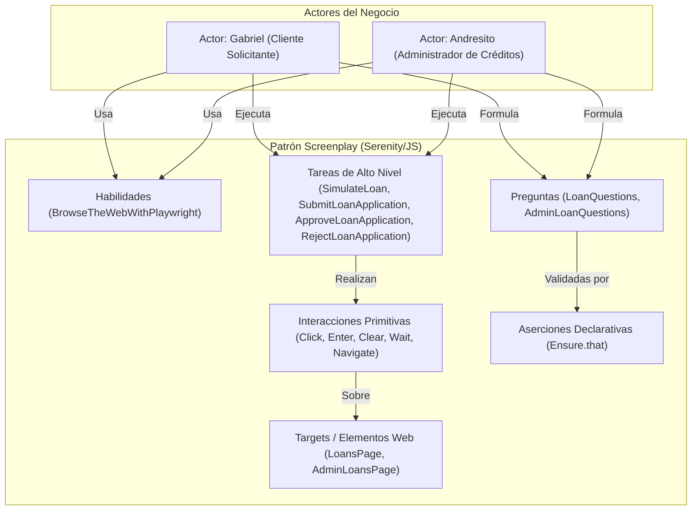

# Automatización de Pruebas E2E con el Patrón Screenplay (Serenity/JS) — Módulo de Créditos

**Rúbrica de Evaluación — Criterio 4 (20 Puntos):**  
> *"Automatización de funcionalidades mediante actores, tareas, interacciones y preguntas. Nivel Alto: Aplica correctamente el patrón, cubre recorridos exitosos y alternativos y verifica resultados mediante aserciones claras. (20 puntos)"*

---

## 1. Justificación y Fundamentación del Patrón Screenplay

El patrón **Screenplay** es una evolución del patrón tradicional *Page Object Model (POM)*. En lugar de centrar la automatización en las páginas y sus elementos técnicos, Screenplay adopta un enfoque centrado en el usuario, formulando la prueba en términos de **quién hace qué y por qué**:



### Componentes de la Arquitectura en FuBanking

| Concepto Screenplay | Implementación en `e2e/serenity/` | Propósito |
|---|---|---|
| **Actor Cliente** | **`Gabriel`** (`actorCalled('Gabriel')` y pronombres `él / ella`) | Representa al cliente financiero que simula y solicita créditos. |
| **Actor Admin** | **`Andresito`** (`actorCalled('Andresito')`) | Representa al funcionario bancario con rol administrador que audita y gestiona créditos. |
| **Abilities (Habilidades)** | `BrowseTheWebWithPlaywright.using(browser)` | Capacitan a los actores para interactuar con la interfaz gráfica web en Chromium. |
| **Tasks (Tareas de Negocio)** | `OpenFuBanking`, `NavigateToLoans`, `SimulateLoan`, `SubmitLoanApplication`, `NavigateToAdminLoans`, `ApproveLoanApplication`, `RejectLoanApplication` | Encapsulan intenciones de negocio sin acoplar los steps de prueba al DOM. |
| **Interactions (Interacciones)** | `Click`, `Enter`, `Clear`, `Navigate`, `Wait` | Acciones primitivas ejecutadas sobre los elementos web. |
| **Targets (Selectores)** | `LoansPage` (`loanAmountInput`, `simulateButton`, etc.), `AdminLoansPage` (`approveButton`, `rejectButton`, etc.) | Localizadores declarativos estables y desacoplados. |
| **Questions (Preguntas)** | `LoanQuestions.simulationResult()`, `LoanQuestions.simulationMessage()`, `AdminLoanQuestions.successAlertMessage()`, `AdminLoanQuestions.loansCount()` | Consultan el estado real del sistema para permitir aserciones declarativas. |
| **Ensure (Aserciones)** | `Ensure.that(..., isVisible())`, `Ensure.that(..., includes(...))` | Validador declarativo de condiciones de aceptación y reglas de negocio. |

---

## 2. Especificación de Escenarios Gherkin (`features/loans.feature`)

Los 7 escenarios están redactados en español formal según la gramática de Cucumber, cubriendo el ciclo de vida completo de clientes y administradores:

```gherkin
# language: es
@web @loans
Característica: Gestión y Simulación de Créditos Bancarios
  Como cliente o administrador de FuBanking
  Quiero simular, solicitar y auditar créditos bancarios
  Para tomar decisiones financieras informadas y gestionar el riesgo crediticio

  @smoke
  Escenario: Simulación exitosa de crédito con cálculo de cuota mensual
    Dado que Gabriel abre la plataforma FuBanking
    Y él ingresa al simulador de créditos
    Cuando él simula un préstamo con monto "5000", cuotas "12" y tasa "18"
    Entonces él observa el resultado de la simulación
    Y él confirma que la simulación está lista

  Escenario: Simulación con valores frontera y límites de crédito
    Dado que Gabriel abre la plataforma FuBanking
    Y él ingresa al simulador de créditos
    Cuando él simula un préstamo con monto "100000", cuotas "72" y tasa "15"
    Entonces él observa el resultado de la simulación
    Y él confirma que la simulación está lista

  Escenario: Validación preventiva ante montos y cuotas en cero
    Dado que Gabriel abre la plataforma FuBanking
    Y él ingresa al simulador de créditos
    Cuando él simula un préstamo con monto "0", cuotas "0" y tasa "18"
    Entonces él observa un mensaje de validación en pantalla

  Escenario: Simulación con tasa de interés de contingencia
    Dado que Gabriel abre la plataforma FuBanking
    Y él ingresa al simulador de créditos
    Cuando él simula un préstamo con monto "20000", cuotas "24" y tasa "0"
    Entonces él observa el resultado de la simulación

  Escenario: Verificación de requisitos de elegibilidad y solicitud de crédito
    Dado que Gabriel abre la plataforma FuBanking
    Y él ingresa al simulador de créditos
    Entonces él observa los requisitos para solicitar crédito en pantalla
    Y él visualiza el botón de solicitar crédito disponible
    Cuando él envía una solicitud de crédito
    Entonces él confirma que la solicitud fue enviada exitosamente

  @admin @approval
  Escenario: Administrador Andresito aprueba una solicitud de crédito pendiente
    Dado que Andresito abre la mesa de control de créditos como administrador
    Entonces él visualiza la lista de solicitudes de crédito
    Cuando él aprueba la primera solicitud de crédito pendiente
    Entonces él confirma que la solicitud fue aprobada exitosamente

  @admin @rejection
  Escenario: Administrador Andresito rechaza una solicitud de crédito alternativa
    Dado que Andresito abre la mesa de control de créditos como administrador
    Entonces él visualiza la lista de solicitudes de crédito
    Cuando él rechaza la primera solicitud de crédito pendiente
    Entonces él confirma que la solicitud fue rechazada exitosamente
```

---

## 3. Cobertura de Recorridos (7 Escenarios: Positivos, Negativos, Frontera y Auditoría Admin)

1. **Recorrido Exitoso Estándar (Smoke — Escenario 1)**:
   - Gabriel simula `$5,000` a `12 cuotas` y tasa `18% EA`.
   - Aserción: `Ensure.that(LoansPage.simulationResultCard(), isVisible())` y mensaje de confirmación.
2. **Análisis de Valores Frontera (BVA — Escenario 2)**:
   - Gabriel simula montos altos (`$100,000`) a plazos extendidos (`72 meses`), garantizando que las fórmulas financieras no se desborden ni trunquen valores.
3. **Validación Defensiva / Negativo (Escenario 3)**:
   - Gabriel ingresa montos o cuotas en `0`. El sistema intercepta y muestra un mensaje amigable de validación en pantalla.
4. **Robustez ante Tasa Cero (Escenario 4)**:
   - Gabriel simula con tasa `0% EA`. El cálculo de amortización opera de forma lineal sin arrojar excepciones de división por cero.
5. **Elegibilidad y Solicitud Formal (Escenario 5)**:
   - Gabriel comprueba los 4 requisitos de perfil, habilita el botón de solicitud y envía el crédito formal a mesa de control.
6. **Golden Path de Aprobación Admin (Escenario 6)**:
   - El funcionario **Andresito** accede a la mesa de control de créditos `/admin/loans`, inspecciona las solicitudes pendientes y aprueba el crédito mediante la tarea `ApproveLoanApplication`.
   - Aserción: Notificación de confirmación exitosa y actualización de estado.
7. **Flujo Alternativo de Rechazo Admin (Escenario 7)**:
   - El funcionario **Andresito** evalúa una solicitud y decide rechazarla mediante la tarea `RejectLoanApplication`.
   - Aserción: Notificación de rechazo y actualización de estado en la bandeja de auditoría.

---

## 4. Comandos de Ejecución y Reportes

```bash
# 1. Ejecutar la suite completa de 7 escenarios con Serenity/JS y Playwright
npm run test:serenity

# 2. Ejecutar únicamente el escenario Smoke de cliente
npm --prefix e2e-serenity run test:smoke

# 3. Levantar el servidor local con el reporte interactivo HTML de Serenity
npm run test:serenity:report
```

El reporte interactivo se genera en `e2e-serenity/reports/serenity-js/index.html` e incluye la cronología paso a paso de cada interacción ejecutada por los actores **Gabriel** y **Andresito**, capturas de pantalla automáticas de cada estado y evidencia visual para auditoría de calidad.
