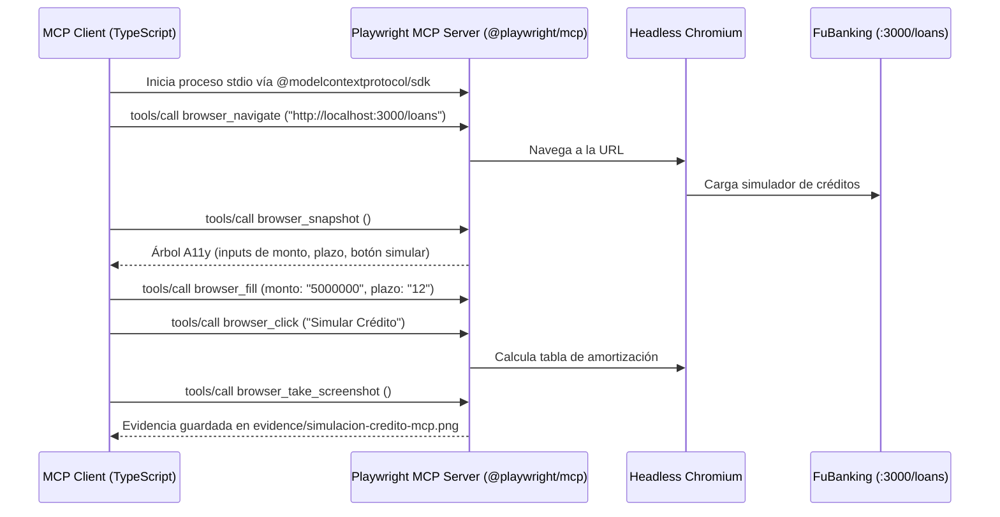

# Microsoft Playwright MCP Server — Automatización E2E para Créditos

Este módulo implementa **Microsoft Playwright MCP Server (`@playwright/mcp`)**, aplicando el estándar abierto **Model Context Protocol (MCP)** para realizar pruebas End-to-End sobre el módulo de Créditos de FuBanking.

---

## 1. ¿Qué es Microsoft Playwright MCP?

El **Model Context Protocol (MCP)** es una especificación abierta desarrollada para conectar de manera segura y desacoplada modelos de lenguaje (LLMs / Agentes de IA) con herramientas externas.

El servidor oficial de Microsoft Playwright (`@playwright/mcp`) expone las capacidades del motor de navegación de Playwright como **herramientas MCP estandarizadas**.

### ¿Por qué es superior al testing tradicional o visual?
1. **Basado en el Árbol de Accesibilidad (`browser_snapshot`):** En lugar de depender de selectores CSS frágiles (clases que cambian con Tailwind) o capturas visuales costosas en tokens, el servidor expone la estructura semántica de accesibilidad del DOM (`role`, `name`, `aria-label`, `ref`).
2. **Determinista y Token-Efficient:** Los agentes de IA pueden razonar sobre el estado de la página en texto plano estructurado y emitir acciones de forma precisa.
3. **Desacoplamiento Total:** Cualquier cliente compatible con MCP (Claude Code, Cursor, Antigravity, o scripts custom con `@modelcontextprotocol/sdk`) puede controlar el navegador sin librerías propietarias.

---

## 2. Herramientas MCP Principales Expuestas

| Herramienta MCP | Descripción |
|---|---|
| `browser_navigate` | Navega a la URL especificada (ej. `http://localhost:3000/loans`). |
| `browser_snapshot` | Obtiene el árbol de accesibilidad actual con referencias semánticas a elementos interactivos. |
| `browser_fill` | Rellena campos de texto o inputs a partir de su referencia semántica. |
| `browser_click` | Hace clic en un botón, enlace o elemento interactivo. |
| `browser_take_screenshot` | Captura evidencia visual de la pantalla en formato PNG. |
| `browser_network_requests` | Inspecciona tráfico de red y respuestas del backend. |

---

## 3. Arquitectura del Runner (`loans-mcp.test.ts`)



---

## 4. Ejecución

Asegúrate de tener corriendo el backend y frontend de FuBanking (`localhost:3000` y `localhost:3001`):

```bash
# Ejecutar la prueba E2E de créditos vía MCP
npm run test:mcp:playwright
```

La evidencia quedará almacenada en `test/pruebas-herramientas/herramientas-bedoya/01-mcp-playwright/evidence/`.
