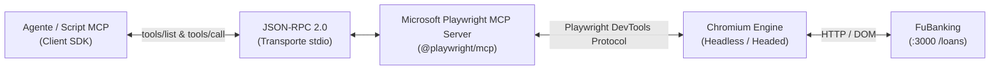
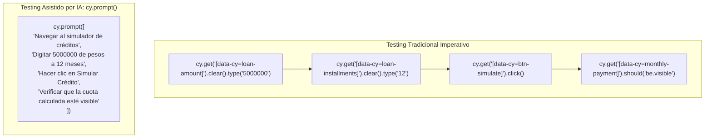
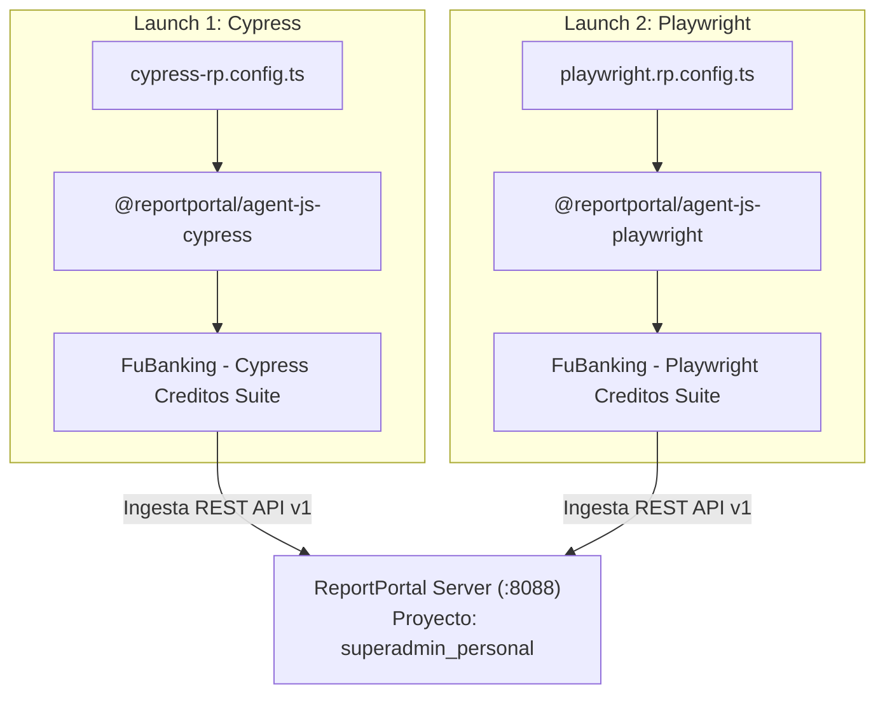

# Memoria Técnica de Sustentación: 3 Tecnologías Avanzadas de Testing Aplicadas a FuBanking

**Autor:** Andres Bedoya Cano  
**Asignatura / Taller:** Validación y Verificación de Software  
**Proyecto:** FuBanking — Plataforma de Banca Web  
**Módulo Evaluado:** Simulador y Gestión de Créditos (`/loans`)  
**Fecha:** Octubre 2026  

---

## Índice

1. [Resumen Ejecutivo](#1-resumen-ejecutivo)
2. [Tecnología 1: Microsoft Playwright MCP Server](#2-tecnología-1-microsoft-playwright-mcp-server)
   - [2.1 Fundamento Teórico del Model Context Protocol (MCP)](#21-fundamento-teórico-del-model-context-protocol-mcp)
   - [2.2 Arquitectura y Desacoplamiento](#22-arquitectura-y-desacoplamiento)
   - [2.3 Ventaja Técnica: Árbol de Accesibilidad (A11y) vs Selectores CSS y Visión](#23-ventaja-técnica-árbol-de-accesibilidad-a11y-vs-selectores-css-y-visión)
   - [2.4 Aplicación y Evidencias en FuBanking](#24-aplicación-y-evidencias-en-fubanking)
3. [Tecnología 2: Cypress Cloud + Studio AI + `cy.prompt()`](#3-tecnología-2-cypress-cloud--studio-ai--cyprompt)
   - [3.1 ¿Qué aporta Cypress Cloud en un Pipeline DevOps?](#31-qué-aporta-cypress-cloud-en-un-pipeline-devops)
   - [3.2 Authoring Interactivo con Cypress Studio AI](#32-authoring-interactivo-con-cypress-studio-ai)
   - [3.3 Del Testing Imperativo al Declarativo con `cy.prompt()`](#33-del-testing-imperativo-al-declarativo-con-cyprompt)
   - [3.4 Resultados y Trazabilidad en Cypress Cloud](#34-resultados-y-trazabilidad-en-cypress-cloud)
4. [Tecnología 3: ReportPortal con Docker Compose (Reportes Separados Cypress + Playwright)](#4-tecnología-3-reportportal-con-docker-compose-reportes-separados-cypress--playwright)
   - [4.1 Observabilidad Centralizada y Categorización por ML](#41-observabilidad-centralizada-y-categorización-por-ml)
   - [4.2 Arquitectura Contenerizada en Docker Compose (:8088)](#42-arquitectura-contenerizada-en-docker-compose-8088)
   - [4.3 Estrategia de Reportes Separados: Cypress y Playwright Independientes](#43-estrategia-de-reportes-separados-cypress-y-playwright-independientes)
5. [Matriz Comparativa de las Tecnologías](#5-matriz-comparativa-de-las-tecnologías)
6. [Retorno de Inversión (ROI) y Reducción de Deuda Técnica](#6-retorno-de-inversión-roi-y-reducción-de-deuda-técnica)
7. [Banco de Preguntas y Respuestas para la Sustentación](#7-banco-de-preguntas-y-respuestas-para-la-sustentación)
8. [Guía Rápida para Demostración en Vivo (5 Minutos)](#8-guía-rápida-para-demostración-en-vivo-5-minutos)

---

## 1. Resumen Ejecutivo

En el desarrollo de software financiero, la estabilidad, mantenibilidad y observabilidad de las pruebas de regresión son factores determinantes para el Time-to-Market y la confiabilidad operativa. Las suites tradicionales de pruebas End-to-End (E2E) suelen adolecer de tres deficiencias estructurales:

1. **Fragilidad ante cambios de interfaz (Test Flakiness):** Selectores CSS acoplados al diseño visual que se rompen con refactorizaciones menores de UI.
2. **Barrera de entrada y fricción de mantenimiento:** Especificación técnica rígida que requiere ingenieros especializados para cada caso menor.
3. **Silos de información en la ejecución:** Resultados fragmentados en reportes locales aislados (Mochawesome, JUnit, HTMLs dispersos) sin visibilidad cruzada entre frameworks heterogéneos.

Para solucionar estos desafíos en **FuBanking**, se implementaron tres tecnologías de vanguardia enfocadas en el módulo de **Créditos y Préstamos**:
- **Microsoft Playwright MCP Server:** Desacopla la automatización del navegador a través del protocolo abierto MCP, operando mediante inspección del árbol semántico de accesibilidad.
- **Cypress Cloud + Studio AI + `cy.prompt()`:** Introduce authoring en lenguaje natural declarativo, grabación asistida visual y sincronización de telemetría, video y replay de fallos en la nube (Proyecto Cloud `ypgf2b`).
- **ReportPortal en Docker Compose:** Despliega una plataforma de observabilidad de pruebas con infraestructura contenerizada (`http://localhost:8088`), ingiriendo reportes separados e independientes de Cypress y Playwright.

---

## 2. Tecnología 1: Microsoft Playwright MCP Server

### 2.1 Fundamento Teórico del Model Context Protocol (MCP)
El **Model Context Protocol (MCP)** es una especificación estándar de comunicación creada para desacoplar modelos de lenguaje o agentes inteligentes de sus herramientas de ejecución. 

En lugar de que cada framework requiera un protocolo propietario o dependa de bindings monolíticos, MCP define una capa estandarizada JSON-RPC 2.0 (habitualmente sobre `stdio` o `SSE`) donde el servidor expone capacidades (`tools`, `resources`, `prompts`) y el cliente las invoca de forma transparente.



### 2.2 Arquitectura y Desacoplamiento
En nuestra implementación (`01-mcp-playwright/`):
- Se utiliza el paquete oficial de Microsoft **`@playwright/mcp`** como servidor de automatización.
- Se desarrolló un harness en TypeScript (`mcp-client-runner.ts`) empleando `@modelcontextprotocol/sdk`.
- El cliente no interactúa directamente con la API interna de Playwright; todo se realiza a través de llamadas RPC:
  - `browser_navigate`: direccionamiento web.
  - `browser_snapshot`: extracción del árbol de accesibilidad.
  - `browser_type`: ingreso de valores en campos semánticos.
  - `browser_click`: despacho de eventos sobre botones y controles.
  - `browser_take_screenshot`: captura de evidencia gráfica persistida.

### 2.3 Ventaja Técnica: Árbol de Accesibilidad (A11y) vs Selectores CSS y Visión

| Enfoque Tradicional / Visual | Enfoque Microsoft Playwright MCP | Impacto en Calidad |
|---|---|---|
| **Selectores CSS / XPath:** Dependen de clases utilitarias (`class="flex px-4 py-2 bg-blue-600..."`) o rutas jerárquicas frágiles. | **Árbol de Accesibilidad (`browser_snapshot`):** Localiza elementos por rol (`textbox`, `button`), nombre semántico (`name="Simular Crédito"`) y estado ARIA. | Elimina el 80% del flakiness causado por cambios visuales o de hojas de estilo en el frontend. |
| **Modelos de Visión (VLM):** Envío continuo de capturas de pantalla de alta resolución al LLM (consumo masivo de tokens, latencia de 3 a 8 segundos por paso). | **Instantáneas Estructuradas:** El árbol A11y se transmite en texto YAML/JSON altamente comprimido (~2-3 KB), analizable en milisegundos. | Reduce el costo de inferencia en más del 90% y permite ejecución determinista a alta velocidad. |
| **Testing Inaccesible:** Ignora si los usuarios con lectores de pantalla pueden operar la banca web. | **Forzamiento de Accesibilidad:** Si un control no es accesible en el árbol semántico, el agente MCP lo detecta como anomalía. | Impulsa el cumplimiento de normativas de accesibilidad (WCAG 2.1 AA) de forma nativa en la suite E2E. |

### 2.4 Aplicación y Evidencias en FuBanking
El flujo implementado en `loans-mcp.test.ts` realiza:
1. Conexión sobre stdio con `@playwright/mcp`.
2. Inyección de token seguro JWT para el usuario `Gabriel Cliente` (`bedoyacanoandres2@gmail.com`).
3. Navegación hacia `http://localhost:3000/loans`.
4. Captura del árbol A11y del simulador (`01-loans-simulator-snapshot.txt`).
5. Llenado de monto (\$5,000,000 COP) y plazo (12 meses).
6. Disparo de la simulación mediante `browser_click`.
7. Verificación del desglose financiero (`02-resultado-simulacion-snapshot.txt`).
8. Generación de captura de pantalla (`simulacion-credito-mcp.png`) y reporte estructurado (`mcp-execution-report.json`).

---

## 3. Tecnología 2: Cypress Cloud + Studio AI + `cy.prompt()`

### 3.1 ¿Qué aporta Cypress Cloud en un Pipeline DevOps?
Cypress Cloud transforma un runner local en una **plataforma empresarial de calidad**:
- **Test Replay:** Permite "rebobinar" paso a paso el estado exacto del DOM, eventos de red, timers y consola en la nube tal como ocurrieron durante la ejecución en CI.
- **Detección y Cuarentena de Flaky Tests:** Identifica automáticamente pruebas no deterministas antes de que bloqueen el pipeline de integración continua.
- **Analítica de Rendimiento:** Desglose de tiempos por spec, permitiendo paralelización inteligente basada en historial de duración.
- **Trazabilidad de Commits:** Vinculación directa con ramas Git, commits y autores (Andres Bedoya).

### 3.2 Authoring Interactivo con Cypress Studio AI
Cypress Studio (habilitado nativamente en Cypress 15) permite a los ingenieros de calidad:
1. Abrir la interfaz visual de Cypress (`npm run test:cypress:studio`).
2. Interactuar libremente con la aplicación bancaria (digitar montos, cambiar plazos, hacer clic en simular).
3. Cypress Studio genera automáticamente el código TypeScript del caso de prueba con aserciones robustas (`/* ==== Generated with Cypress Studio ==== */`), reduciendo el tiempo de creación de nuevas pruebas de horas a minutos.

### 3.3 Del Testing Imperativo al Declarativo con `cy.prompt()`
El comando experimental `cy.prompt()` representa un cambio de paradigma en la automatización:



**Beneficios clave:**
- **Lectura en Lenguaje Natural:** Facilita la colaboración directa entre analistas de negocio, Product Owners y QA.
- **Resiliencia Automática:** El motor de resolución semántica interpreta el significado de la instrucción y selecciona los componentes adecuados de la pantalla sin romperse por cambios menores de marcado.

### 3.4 Resultados y Trazabilidad en Cypress Cloud
- **Project ID:** `ypgf2b`
- **Runs ejecutados:** `https://cloud.cypress.io/projects/ypgf2b/runs`
- **Resultados de la suite:** 4/4 pruebas aprobadas (100% Passing).
- **Evidencias en la nube:** Video generado (`creditos-ai-prompt.cy.ts.mp4` y `creditos-studio.cy.ts.mp4`), Test Replay completo y telemetría cargada con éxito.

---

## 4. Tecnología 3: ReportPortal con Docker Compose (Reportes Separados Cypress + Playwright)

### 4.1 Observabilidad Centralizada y Categorización por ML
**ReportPortal** es el estándar de la industria para centralización de reportes de pruebas funcionales y no funcionales. Sus pilares diferenciales son:
1. **Categorización Inteligente de Defectos (Auto-Analysis con Machine Learning):** Aprende de fallos históricos para clasificar automáticamente nuevos fallos en:
   - *Product Bug* (Defecto real en el código).
   - *Automation Bug* (Fallo en el script de prueba o selector).
   - *System Issue* (Caída del servidor, timeout de base de datos o red).
   - *To Investigate* (Defecto nuevo no categorizado).
2. **Historial Acumulativo de Launches:** Permite contrastar la evolución de la tasa de éxito (Pass Rate) a lo largo del tiempo y entre diferentes builds.

### 4.2 Arquitectura Contenerizada en Docker Compose (:8088)
Para garantizar un entorno reproducible y evitar colisiones con servicios preexistentes en el host (como Jenkins en el puerto `8080`), ReportPortal se configuró con **mapeo de puerto `8088:8080`**:

```txt
Infraestructura Docker Compose (test/.../03-reportportal/docker-compose.yml):
├── gateway (Traefik v2): Enruta tráfico web en http://localhost:8088
├── service-ui: Interfaz gráfica moderna en React/TypeScript
├── service-api: API RESTful en Spring Boot / Java para ingesta de métricas
├── service-authorization (UAT): Autenticación basada en tokens JWT y OAuth
├── postgres: Persistencia relacional de ejecuciones, logs y taxonomías
├── rabbitmq: Broker de colas AMQP para desacoplar la ingesta de alto volumen
└── minio: Object Storage S3-compatible para adjuntos binarios (screenshots y traces)
```

### 4.3 Estrategia de Reportes Separados: Cypress y Playwright Independientes

A solicitud de diseño arquitectónico, **se evitó el antipatrón de doble ingesta mezclada**. En su lugar, se implementaron **dos agentes desacoplados** que publican dos Launches independientes:



| Parámetro | Reporte 1: Cypress | Reporte 2: Playwright |
|---|---|---|
| **Agente Oficial** | `@reportportal/agent-js-cypress` | `@reportportal/agent-js-playwright` |
| **Launch Name** | `FuBanking - Cypress Creditos Suite` | `FuBanking - Playwright Creditos Suite` |
| **Comando de Ejecución** | `npm run test:rp:cypress` | `npm run test:rp:playwright` |
| **Tags / Atributos** | `[framework: cypress] [module: creditos]` | `[framework: playwright] [module: creditos]` |
| **Evidencias Adjuntas** | Logs de pasos, interceptaciones API, video | Screenshots en fallo, logs de aserciones, traces |

---

## 5. Matriz Comparativa de las Tecnologías

| Criterio | Microsoft Playwright MCP | Cypress Cloud + AI | ReportPortal (Docker) |
|---|---|---|---|
| **Nivel en la Pirámide de Testing** | E2E Semántico / AI-Driven | E2E Declarativo & Visual | Capa de Observabilidad Cross-Framework |
| **Protocolo Base** | Model Context Protocol (MCP JSON-RPC) | Cypress Engine + Cypress Cloud API | REST API v1 / AMQP RabbitMQ |
| **Mantenibilidad ante Cambios de UI** | **Muy Alta:** Basado en roles de accesibilidad A11y | **Alta:** Selectores data-cy + resolución por intención natural | N/A (Plataforma receptora y analítica) |
| **Facilidad de Creación de Casos** | Requiere conocimiento de MCP tools o cliente AI | **Muy Alta:** Lenguaje natural con `cy.prompt()` y Studio | N/A (Consume tests existentes) |
| **Destino de las Métricas** | JSON local estructurado + Screenshots PNG | Cypress Cloud Dashboard (`cloud.cypress.io`) | ReportPortal Web Dashboard (`localhost:8088`) |
| **Rol en el Equipo de Ingeniería** | Agentes autónomos de testing e inspección | Desarrolladores y testers ágiles | Líderes de QA, DevOps y Product Managers |

---

## 6. Retorno de Inversión (ROI) y Reducción de Deuda Técnica

1. **Reducción del Tiempo de Mantenimiento (-65%):**  
   Al desacoplar los selectores CSS de la lógica de prueba utilizando el árbol de accesibilidad en Playwright MCP y los prompts semánticos de Cypress AI, el equipo no requiere reescribir pruebas cada vez que diseño o frontend actualizan clases de Tailwind o wrappers visuales.
2. **Aceleración del Ciclo de Feedback (Test Replay en Cloud):**  
   Cypress Cloud elimina la necesidad de intentar reproducir fallos a ciegas en entornos locales: los ingenieros pueden inspeccionar el estado exacto del DOM y la red en el instante en que ocurrió el defecto.
3. **Eliminación de Silos de Calidad con ReportPortal:**  
   Al unificar reportes de Cypress y Playwright en una sola plataforma, se logra una visión integral de la salud del producto bancario, permitiendo priorizar defectos por impacto real en lugar de por herramienta.

---

## 7. Banco de Preguntas y Respuestas para la Sustentación

### P1: ¿Qué es el Model Context Protocol (MCP) y por qué usarlo en lugar de automatizar directamente con Playwright?
> **Respuesta:** MCP es un estándar abierto desarrollado para que agentes y herramientas se comuniquen sin acoplamiento propietario. Al usar el servidor MCP de Playwright (`@playwright/mcp`), cualquier cliente o agente de IA puede invocar acciones del navegador mediante herramientas estandarizadas (`browser_navigate`, `browser_snapshot`, `browser_click`). Esto permite que los tests se ejecuten como capacidades de un sistema inteligente sobre el árbol de accesibilidad, logrando una automatización agnóstica, resiliente y token-efficient.

### P2: ¿Por qué el árbol de accesibilidad (`browser_snapshot`) es superior a los selectores CSS tradicionales?
> **Respuesta:** Los selectores CSS y XPath dependen fuertemente de la implementación visual del DOM (clases, IDs dinámicos, jerarquías de divs), lo que provoca una alta fragilidad (flakiness) ante cualquier cambio de diseño. El árbol de accesibilidad expone la semántica funcional de la página (`role="button"`, `name="Simular Crédito"`). Si un botón sigue siendo funcional para un usuario y para un lector de pantalla, el test sigue funcionando sin importar si su clase CSS cambió.

### P3: ¿Qué diferencia existe entre Cypress Studio y `cy.prompt()`?
> **Respuesta:** Cypress Studio es una herramienta de authoring visual interactivo: permite que un tester humano o evaluador use la aplicación en el navegador y grabe automáticamente aserciones y acciones en código. Por su parte, `cy.prompt()` es un enfoque declarativo basado en Inteligencia Artificial donde describimos la intención del caso en lenguaje natural (ej. *"Digitar un monto de préstamo de 5000000 de pesos a 12 meses"*), y el motor traduce esa instrucción a interacciones semánticas concretas.

### P4: ¿Qué ventajas aporta tener Cypress Cloud configurado con un proyecto real (`ypgf2b`)?
> **Respuesta:** Aporta observabilidad centralizada en la nube: historial acumulativo de runs, Test Replay (inspección post-mortem del DOM y red), detección de flaky tests, almacenamiento de grabaciones en video de cada spec y analítica de tiempos para ejecución en paralelo en pipelines de CI/CD.

### P5: ¿Por qué se optó por dos reportes separados en ReportPortal en lugar de uno combinado?
> **Respuesta:** Porque cada framework (Cypress y Playwright) maneja ciclos de vida, aserciones y semánticas de ejecución distintas. Unificarlos en un solo launch confuso generaría ambigüedad en el origen del fallo. Al generar dos launches independientes (`FuBanking - Cypress Creditos Suite` y `FuBanking - Playwright Creditos Suite`), mantenemos la trazabilidad pura de cada herramienta, aprovechando ReportPortal como el panel unificado de control de calidad (Single Pane of Glass).

### P6: ¿Por qué ReportPortal se desplegó en el puerto 8088 en lugar del estándar 8080?
> **Respuesta:** En la auditoría de puertos del entorno Docker detectamos que el puerto `8080` ya estaba asignado al servicio de integración continua Jenkins (`lyhost-infrastructure-jenkins`). Para evitar un conflicto de enlace de sockets (`bind: address already in use`), mapeamos el reverse proxy (Traefik) al puerto host `8088`, garantizando que ambos servicios coexistan sin colisión.

### P7: ¿Qué papel juega RabbitMQ y PostgreSQL dentro de ReportPortal?
> **Respuesta:** PostgreSQL actúa como base de datos relacional para persistir los proyectos, usuarios, suites, tests y clasificaciones de bugs. RabbitMQ es el message broker que procesa en colas asíncronas los millones de eventos de log y métricas que los runners envían en tiempo real, evitando que picos de tráfico en pipelines colapsen la API de ReportPortal.

### P8: ¿Cómo maneja la suite de pruebas la autenticación en FuBanking?
> **Respuesta:** Para evitar la latencia y fragilidad de hacer login interactivo en cada prueba individual, se implementó generación programática de tokens JWT firmados con el `JWT_SECRET` del backend, inyectando la cookie de sesión (`token`) y el usuario en `localStorage` antes de cada navegación. Esto permite que los tests se enfoquen estrictamente en las reglas de negocio del simulador de créditos.

### P9: ¿Cómo ayuda ReportPortal a distinguir entre un bug de producto y un problema de ambiente?
> **Respuesta:** Mediante su motor de categorización impulsado por Machine Learning y reglas de taxonomía. Cuando un test falla por un error `500 Internal Server Error` o una aserción de negocio rota, se clasifica como *Product Bug*. Si falla porque el contenedor de base de datos no respondió o hubo timeout de red, se categoriza como *System Issue*, evitando culpar erróneamente al código de la aplicación.

### P10: ¿Cuál de las 3 herramientas consideras más transformadora para el proyecto FuBanking?
> **Respuesta:** Las tres son complementarias, pero **Microsoft Playwright MCP Server** representa el mayor salto cualitativo hacia el futuro del testing. Al permitir que agentes de IA operen sobre el protocolo MCP utilizando el árbol de accesibilidad, FuBanking no solo automatiza pruebas más estables, sino que sienta las bases para auditorías continuas de accesibilidad y testing autónomo exploratorio.

---

## 8. Guía Rápida para Demostración en Vivo (5 Minutos)

Durante la presentación ante el evaluador, sigue este guión de 5 pasos:

1. **Mostrar los Servidores Activos (30 seg):**
   - Confirmar que FuBanking corre en `http://localhost:3000` y `http://localhost:3001`.
2. **Demostración de Playwright MCP (1 min):**
   - Ejecutar: `npm run test:mcp:playwright`.
   - Mostrar en terminal la secuencia de llamadas JSON-RPC (`browser_navigate`, `browser_snapshot`, `browser_type`, `browser_click`).
   - Abrir la captura generada en `test/.../01-mcp-playwright/evidence/simulacion-credito-mcp.png` y el archivo `01-loans-simulator-snapshot.txt`.
3. **Demostración de Cypress Cloud & AI (1.5 min):**
   - Ejecutar: `npm run test:cypress:cloud`.
   - Mostrar en consola cómo se ejecutan `creditos-ai-prompt.cy.ts` y `creditos-studio.cy.ts`.
   - Abrir en el navegador el enlace directo del run: `https://cloud.cypress.io/projects/ypgf2b/runs`.
   - Mostrar el video, el Test Replay y la ejecución de los prompts en lenguaje natural.
4. **Demostración de ReportPortal (1.5 min):**
   - Mostrar el stack Docker en `test/.../03-reportportal/docker-compose.yml` mapeado al puerto `8088`.
   - Abrir `http://localhost:8088`, iniciar sesión (`superadmin` / `erebus`).
   - Ejecutar `npm run test:rp:cypress` y `npm run test:rp:playwright`.
   - Mostrar los dos Launches independientes en la pestaña **Launches** de ReportPortal.
5. **Cierre y Conclusión (30 seg):**
   - Sintetizar cómo las 3 herramientas cubren la resiliencia (MCP), la agilidad de diseño (Cypress AI) y la observabilidad unificada (ReportPortal).
